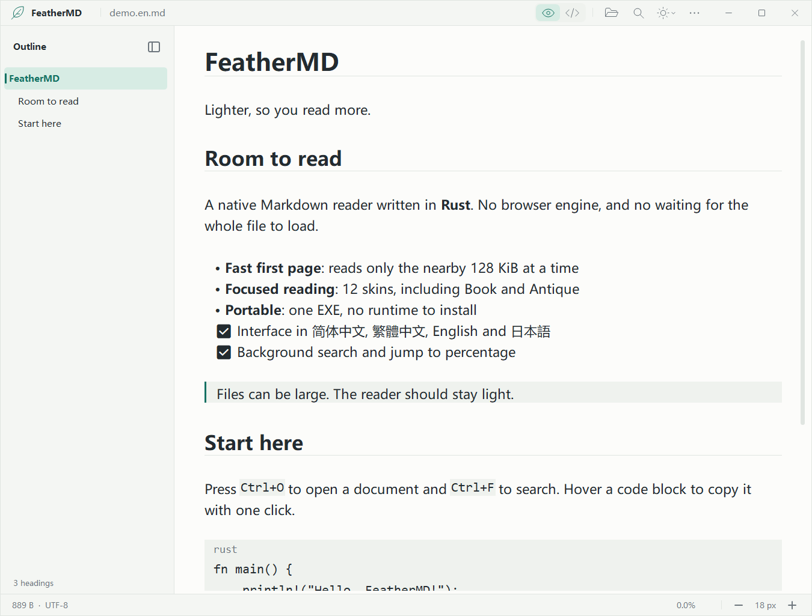
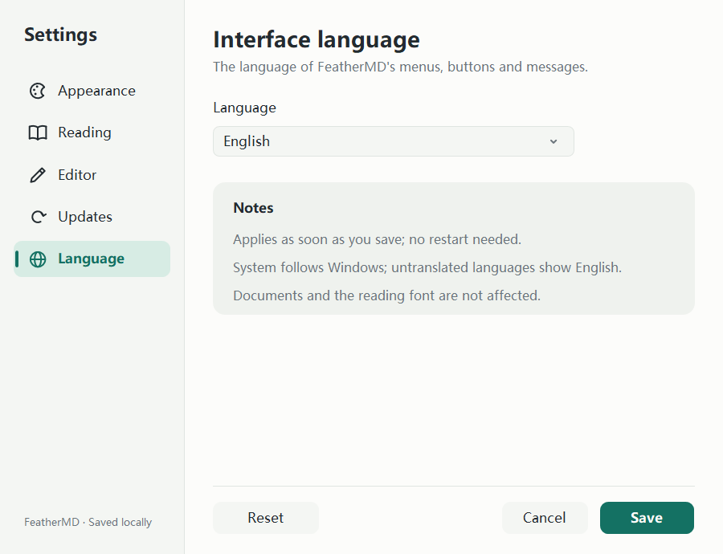
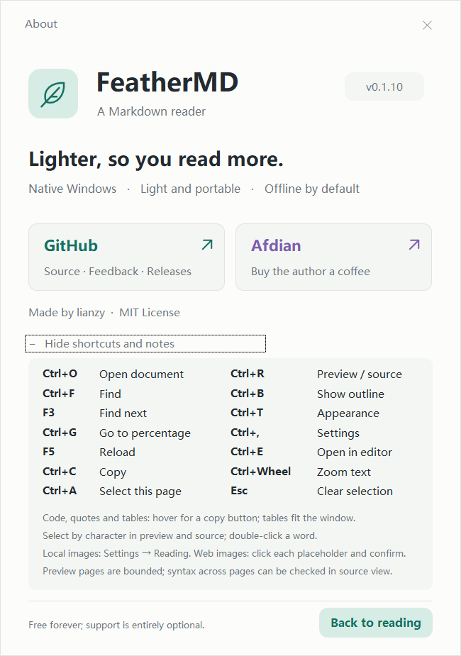

# FeatherMD

[简体中文](README.md) · [繁體中文](README.zh-TW.md) · **English** · [日本語](README.ja.md)

[](LICENSE)
[](https://ifdian.net/a/lianzy)

**Lighter, so you read more.** A native Windows Markdown viewer written in Rust. The interface speaks Simplified Chinese, Traditional Chinese, English and Japanese.

[Download the single-file EXE](https://github.com/Lianzy-Baimiao/FeatherMD/releases/latest) · [Performance and validation](docs/PERFORMANCE.md) (Chinese) · [Architecture notes](docs/ARCHITECTURE.md)



The 34 px title bar stays quiet: the feather mark and the document name on the left; on the right, **Open / Find / Appearance / More** share one size and line weight, and hovering shows a soft rounded backdrop with a name and shortcut. The window buttons light up as whole columns, and Close turns red. The **eye / code** switch between preview and source sits at the left of the status bar. Icons are anti-aliased GDI+ vectors: straight lines sit on the pixel grid and curves stay smooth.

**Appearance is a single button** (a half-filled circle). Click it for Light / Dark / System; the fourth row, "More skins…", opens the 20 skins in Settings. **Ctrl+T** opens it too: choose with the arrow keys or Tab, Enter to apply, Esc to cancel.

**Right-click → Edit** (Ctrl+E) opens the document in the editor you chose. FeatherMD itself stays read-only; after saving, F5 reloads it at the same place.

**One-click copy**: hover a code block, quote or table and a Copy button appears in its top-right corner. Code is copied as source (without the fences), tables as tab-separated cells.

The outline toggle stays with the outline: right of its heading while it is shown, at the left edge of the text once hidden. Without a document there is no empty outline column.

New settings follow the system theme and refresh when the Windows app colour changes; an explicit Light or Dark choice is never overridden. Switching skins keeps your reading position, and the view mode and skin are kept across restarts.

The other screenshots in this README show the Simplified Chinese interface; every view is also available in English (see [Interface language](#interface-language)).

<details>
<summary>More previews: dark reading, hidden outline and the welcome page</summary>


</details>

## Why

Opening a Markdown file should not start a browser first.

FeatherMD uses Win32 and GDI/GDI+: no Electron, WebView, JavaScript or telemetry, and it is offline by default. It contacts GitHub Releases only when you enable or manually run update checks; web images load only after you click and confirm each URL. The v0.1.10 Windows x64 EXE is about **1.05 MiB** (four interface languages, code highlighting and local image decoding included) and needs no .NET, VC++ runtime or other third-party runtime.

**Large files are not loaded whole before they show.** Only the nearby 128 KiB is read at a time; reading and searching run in the background and only visible lines are drawn. The file's total size does not decide how much memory the first page needs.

## Use

1. Download **FeatherMD.exe** from Releases, put it in a folder you like and double-click it.
2. Drop a Markdown file on the window, or press **Ctrl+O**.
3. Click a heading in the outline to jump to it. The button right of the "Outline" heading hides the outline and the one at the left edge of the text shows it again; **Ctrl+B** toggles it, and the choice is kept.
4. The eye / code switch at the left of the status bar changes between preview and source (Ctrl+R); the appearance button picks a skin. The ellipsis "More → Settings…" (Ctrl+,) changes skins, opacity, the reading font and size, whether images are shown, the default editor and the interface language; word wrap and the reading width are in More too.
5. **More → About FeatherMD** (F1) shows the version, shortcuts and reading notes, and links to the GitHub project page and to Afdian to support the author. External links ask first, then open in your default browser.
6. **More → Check for updates…** checks for a new version by hand; the Settings "Updates" page can also check at startup (off by default).
7. **More → Language…** switches the interface language; it applies as soon as you save.

Windows 10 (1607+) / Windows 11 **x64**. Tested on Windows 11 x64; other versions have not each been checked on real hardware. No installer and no administrator rights. The EXE is not code-signed yet, so Windows SmartScreen may warn about an unknown publisher; check the source and the SHA-256 instead of turning protection off.

### Reading layout, code highlighting and HTML tags

The default size is 16 px with lines about 1.6 times as tall; a blank line is a paragraph gap a little shorter than a line, headings have more room above than below, and levels one and two get a thin rule (a wrapped heading draws it under its last line only). Wrapped list items line up with their text, task items show checkboxes, quotes get a grey bar and secondary text, and table body rows are lightly striped.

Code blocks sit on a rounded panel in a slightly smaller monospace font with the language in the top-left corner. **Code highlighting** covers Rust, C/C++, C#, Java/Kotlin/Scala, Swift, Go, JavaScript/TypeScript, Python, Ruby, PHP, Lua, SQL, shell, PowerShell, batch files, JSON, YAML, TOML/INI, Dockerfile, CSS, HTML/XML and diff: keywords, types, function names, strings, numbers and comments get colours tuned to each skin, and block comments and multi-line strings keep their colour across lines. Inline code and `<kbd>` keys are small rounded chips.

Common **HTML tags** shape the text: `<p>`, `<h1>`–`<h6>`, `<br>`, `<hr>`, `<b>`/`<strong>`, `<i>`/`<em>`, `<u>`, `<s>`/`<del>`, `<code>`, `<kbd>`, `<mark>`, `<sub>`/`<sup>`, `<a>`, ``, `<blockquote>`, `<ul>`/`<ol>`/`<li>`, `<pre>`, `<div>`/`<span>`/`<center>`, `<details>`/`<summary>` (always open), centre/right alignment from `align` attributes and `text-align` styles, and common character entities. The `<h1 align="center">` many READMEs open with goes into the outline too. The content of `<script>`, `<style>`, `<iframe>` and the like is neither shown nor run: tags only change the layout and never execute anything.


### Skins and opacity

**More → Settings… → Appearance**: 20 skins, light ones first — System, Light, **Paper** (plain white), Mist, Sky, Eye care, **Book** (a warm white page on a linen desk), **Antique** (rice paper, ink-black text, cinnabar accents and a double ruled frame), **Newsprint** (warm grey paper with navy links), Sage, Sakura, **Lilac**; then Dark, **Dusk** (a softer grey for night reading), **Polar** (cool slate blue), Midnight, **Deep sea** (dark teal), **Violet**, **Mocha** (warm brown with amber) and Black (for OLED). Picking one previews it on the reader at once, the arrow keys move between cards, Cancel or Esc restores the old one, and a saved choice survives restarts. Code highlighting colours follow each skin.

**Window opacity** 30%–100% in 5% steps, by dragging or with the arrow keys. It applies only to the reader window; Settings stays opaque, and at 100% no layered window is used. In every skin, body text keeps at least 9.8:1 contrast against its background, secondary text at least 4.3:1 and links at least 4.5:1 (unit-tested).


<details>
<summary>Skin settings and the Book / Antique skins</summary>


</details>

### Edit with your editor

FeatherMD is read-only. To change a document, **right-click the text → Edit** or press **Ctrl+E**: the document is handed to the editor as one quoted argument. After saving, press **F5** in the reader to reload it at the same place. The context menu also has Copy, Select all on this page, Find and Reload; **Shift+F10** and the menu key open it as well.

**More → Settings… → Editor** chooses the default editor:

- **System default**: the Edit action Windows has registered for the file type, or the system Notepad if there is none.
- **Notepad**, and detected VS Code, VSCodium, Cursor, Typora, MarkText, Notepad++, Sublime Text, Zed and EmEditor (only fixed install locations and App Paths entries are checked; no disk scanning).
- **Browse…** for any .exe on a local drive. Only absolute paths starting with a drive letter are accepted, and FeatherMD itself cannot be chosen.

If the editor is missing, FeatherMD says so and lets you choose another right away. This setting never changes Windows default apps or file associations.


### One-click copy for code, quotes and tables

In the preview, hover a code block, quote or table and a **Copy** button appears in its top-right corner; one click copies the whole block:

- **Code blocks**: the source as it is in the file, without the ```` ``` ```` fence lines; indented code loses one level of indentation. Tabs are kept and lines end with CRLF.
- **Quotes**: the text as shown; a line that wraps on screen is not split.
- **Tables**: each row as tab-separated cells, ready to paste into a spreadsheet.

In a long code block the button keeps to the top of the visible part, so there is no need to scroll back. Beside a table narrower than the text, the button sits to its right instead of over the header. After copying, the button shows a check mark for about 1.5 seconds and the status bar says what was copied. A block that runs past the cached page (about 128 KiB) copies only its loaded part, and the status bar says so. Source view has no copy buttons; select by character there instead.


### Images

**More → Settings… → Reading → Show images** is **off by default**. While it is off, local images show as "[Image: alt text]" and no images are read automatically.

When it is on, **images on this computer** are shown automatically: relative paths start from the document's folder (so does `/assets/a.png`), and absolute drive paths and `file:///C:/…` work too. The format is recognised from the file's content (PNG, JPEG, GIF, BMP, TIFF, ICO), not its extension; JPEGs are turned upright from their EXIF orientation, transparent parts show the skin behind them, and a GIF shows its first frame. Images scale with the DPI in CSS pixels, `` sets their size, and they shrink to the text width and never grow taller than the reading area. Lines of only images (logos, screenshots, badges) and small icons inside a paragraph both show, and a linked image can be clicked.

**Manual web images (v0.1.10):** Click an HTTP(S) image placeholder in the preview, check its URL and confirm to load that address only, even with "Show images" off. Failed loads offer a retry; repeated URLs share an in-memory result. Other images never download automatically. No cookies, credentials, referer or files are sent/saved; the image host receives your IP address. F5, reopening or restarting requires another confirmation. Only direct HTTP(S) raster-image URLs are supported: no redirects, SVG/WebP or images in table cells.


These are **never read**; their alt text and the reason show in their place instead: addresses without an explicit HTTP(S) scheme (such as `//host/…`), files behind a symbolic link or junction, network drives and shares, device paths, online-only OneDrive files that are not downloaded, missing files, unsupported formats such as SVG or WebP, and images over 32 MiB, 32 megapixels or 16384 px on a side.

Reading and decoding happen on a background thread, so the page never waits; a page shows at most 64 images, decoded images share a budget of about 160 MiB, and images of earlier pages go first. Turning the option off frees every image at once.


### Interface language

The interface is available in **简体中文 (Simplified Chinese), 繁體中文 (Traditional Chinese), English and 日本語 (Japanese)**. By default it follows the Windows display language: Taiwan, Hong Kong and Macao use Traditional Chinese, other Chinese locales Simplified Chinese, Japanese uses Japanese, and languages without a translation show English.

Pick a language under **More → Language…** (the Settings "Language" page). After Save, menus, buttons, messages and dialogs switch at once, without a restart. Each language uses an interface font with its own regional glyph forms (Microsoft YaHei UI, Microsoft JhengHei UI, Yu Gothic UI); documents and the reading font are not affected. This README is also available in [简体中文](README.md), [繁體中文](README.zh-TW.md) and [日本語](README.ja.md).



### Tables

GitHub-style pipe tables (a header row plus a `| --- | :-: | --: |` delimiter row) show as a grid with a shaded header and rules. Cells keep bold, inline code and links, and the colons in the delimiter row set left, centre or right alignment.

Columns fit the window: when the table fits, each column keeps its content width; when it does not, the widest columns narrow first and short ones stay as they are, and cells wrap by word or CJK character without starting a line with a comma or full stop. Narrowing the window, hiding the outline or zooming reflows the table at once.

When there are too many columns for even the narrowest readable width (about six characters each), only that table scrolls horizontally (bottom scrollbar, Shift+wheel or the left/right arrow keys); the text and tables that fit stay in place. With word wrap off, tables keep their content width and scroll with the text.


### Character selection

Both the preview and source view (Ctrl+R) select by character with the mouse: double-click selects a word, Shift+click extends the selection, and dragging past the top or bottom of the text scrolls and keeps selecting. Ctrl+A selects the loaded page, Esc clears the selection, and Ctrl+C or right-click "Copy selected text" copies it; without a selection, Copy takes what is visible.

- **The preview** copies the text as shown: the wrapped lines of one paragraph join into one line (with the spaces taken out at the wraps put back), paragraphs are separated by CRLF, table rows are selected whole and copy as tab-separated cells, and an image copies its alt text. Zooming, resizing or images arriving keep the same characters selected.
- **Source view** copies the **source** in the file: tabs stay tabs, CJK and emoji are never cut, lines are joined with CRLF, and a very long line split on screen gets no extra breaks.

A selection reaching past the cached page (about 128 KiB) copies only the loaded part, and the status bar says so. To copy one code block, quote or table, its Copy button is quicker.


### Check for updates

The update source is this project's [GitHub Releases](https://github.com/Lianzy-Baimiao/FeatherMD/releases).

- **Manual check**: More → Check for updates… opens the Settings "Updates" page and checks at once. The result is "You're up to date", "Update available" (with the release name and date) or why the check failed (network, proxy, GitHub rate limit and so on).
- **Check at startup**: tick it on the "Updates" page and save; it is **off by default**. When on, FeatherMD checks in the background about 3 seconds after starting, at most once every 24 hours; a failed check stays quiet and is retried on a later start.
- **When a newer release exists**, the More button gets a small dot and the menu entry reads "Update available: vX.Y.Z…"; both go away once you upgrade. "Download page…" asks first, then opens that release page in your default browser.

The check is one HTTPS request for the public release information on `api.github.com`, made with Windows' own WinHTTP and using the system proxy settings and certificate validation. No documents, settings or other data are sent, and nothing is **downloaded or installed automatically**. With the automatic check off and without "Check now", FeatherMD never goes online.


### Font and default size

**More (…) → Font and default size…** (the Settings "Reading" page): pick any installed font, Latin or CJK, and a default size of **12–36 px** with a live preview. Save applies and remembers it; Cancel or Esc leaves the current settings alone, and Reset only resets this page's draft until you save.

The body font is used for headings too; interface text keeps its own font, and source view, code blocks and inline code stay monospaced. Characters missing from a font fall back to other Windows fonts. The default size is 16 px, and the default body font follows the interface language (Microsoft YaHei UI for Simplified Chinese and English, Microsoft JhengHei UI for Traditional Chinese, Meiryo for Japanese) and changes with it; once you pick another font, that font stays. The size is the same saved value that Ctrl+wheel and Ctrl+plus / minus change, so later documents and restarts use the size you saved last.

The header and welcome icons are anti-aliased GDI+ vector curves with round caps, drawn at the display's DPI; there is no icon font, image download or third-party runtime.

<details>
<summary>Font settings, light and dark</summary>


</details>

### About and project links

**More → About FeatherMD** (F1): a native window in the reader's colours with the version, the GitHub project page and the Afdian page. Expand "Shortcuts and reading notes" for two columns of shortcuts (including Ctrl+E edit, Ctrl+, settings, Ctrl+T appearance and Esc to clear a selection) and notes on one-click copy, table layout, character selection, showing images and the paged preview. Tab, Enter and Esc work. The window follows the current skin and interface language.

<details>
<summary>The About window: English (light) and Simplified Chinese (dark)</summary>




</details>

### Open with and default app


- Put the EXE in a **fixed location** first.
- **More → File associations → Add to Open with for Markdown** registers FeatherMD in the current user's Open with list, without a confirmation or Windows Settings.
- To open .md files with FeatherMD on double-click, choose **More → File associations → Make default for .md (Windows asks)…**. It registers FeatherMD and opens Windows Default apps; pick **.md → FeatherMD** there. Older Windows versions may show the Default apps home page instead, where you search for .md.
- If FeatherMD is not in the list, check that you are running the **new EXE in its fixed location**, repeat the step above, and close and reopen the Default apps page. Search for FeatherMD in the app list or for `.md` under file types; if it still does not appear, browse to the EXE under "Choose another app". Being in the list does not make it the default.
- You can also right-click a .md file → Open with → Choose another app → FeatherMD → Always.
- .md / .markdown / .mdown / .mkd are registered.
- "Remove from Open with…" removes only FeatherMD's own entries.

Windows 10/11 require the user to confirm default apps in Windows itself; ordinary desktop programs have no supported way to set them silently. So "Add to Open with" completes silently, while "Make default" still needs that confirmation. After moving the EXE, register it again; removing the registration does not choose another default viewer for you.

Details and Microsoft's documentation are in [File associations](docs/FILE_ASSOCIATIONS.md) (Chinese).

### Outline and navigation

- A custom title bar, frame and window buttons, with no separate toolbar, leave more room for the text.
- A collapsible outline of headings scrolls with its own wheel and jumps to the heading you click; it is built in the background without delaying the first page.
- Custom vertical and horizontal scrollbars support dragging and paging on the track. After a quick drag far away and back, a stale page never pulls the reading position away. Short files hide the scrollbars they do not need.
- End shows the whole last screen, even when the last paragraph is long and wrapped. PageUp / PageDown page by the real line heights and keep one overlapping line, so large headings never make you skip text. Paging back across cached pages keeps the wrap position of long paragraphs, and Copy without a selection takes the lines actually visible.

The outline lists `#` to `######` headings and skips code fences. To keep large files responsive it scans at most the first **16 MiB** and shows up to **4096 headings**, with a note at the bottom when a limit is reached. Setext (underlined) headings are not listed; reading and full-text search are not limited to the outline's range. Reload (F5) rebuilds the outline.

### Shortcuts

| Action | Shortcut |
| --- | --- |
| Open a file | Ctrl+O / drag and drop |
| Show / hide the outline | Ctrl+B / the toggle by the outline |
| Find in the background (case-sensitive source search) | Ctrl+F |
| Next match (wraps at the end) | Enter / F3 |
| Cancel the search / close the search bar | Esc |
| Go to a byte percentage | Ctrl+G |
| Start / end of the file | Home / End |
| Scroll | Wheel / ↑↓ / PageUp / PageDown / Space |
| Larger / smaller text | Ctrl+wheel / Ctrl++ / Ctrl+- |
| Switch source / preview | Ctrl+R |
| Appearance (Light / Dark / System / More skins) | Ctrl+T / the appearance button |
| Settings (skins, opacity, font, editor, language) | Ctrl+, |
| Open the document in the default editor | Ctrl+E / right-click the text → Edit |
| Context menu | Right-click / Shift+F10 / menu key |
| Reload (keeps the reading position) | F5 |
| Select the loaded page | Ctrl+A |
| Copy the selection (the shown text in the preview, the source in source view); visible text when nothing is selected | Ctrl+C |
| Copy a whole code block, quote or table | Hover the block → Copy in its top-right corner |
| Clear the selection | Esc |
| Reset reading settings | Ctrl+0 |
| Check for updates | More → Check for updates… |
| Interface language | More → Language… |
| Help | F1 |

Mouse selection is **by character** in both the preview and source view (double-click selects a word, Shift+click extends); preview tables select whole rows. With word wrap off, or for a table that is too wide, use the bottom scrollbar or the left/right arrow keys.

### Settings file

Settings go to %APPDATA%\FeatherMD\settings.ini and are saved on every change; the document itself is always read-only. Skin, opacity and editor are stored as `theme`, `opacity` and `editor`; showing images as `images` (`true` / `false`, default `false`); an empty `font_family` means the body font follows the interface language; the automatic check as `update_check`, and the time of the last successful check and the latest version it saw as `update_checked` and `update_latest`. The interface language is `language` (`system`, `zh-CN`, `zh-TW`, `en` or `ja`; default `system`). Invalid values fall back to defaults, and UTF-8 files with a BOM are read too.

For portable settings, create an empty **FeatherMD.ini** next to the EXE; settings are then kept in that file. A single-file setup does not need it. Recent files and document text are never written to settings.

## What it reads, and its limits

- Documents in UTF-8 / UTF-8 with BOM, in any Unicode the system fonts can show (any language). The interface is in Simplified Chinese, Traditional Chinese, English and Japanese.
- Headings, bold, italic, strikethrough, inline code, code fences (common languages highlighted), quotes, lists, task lists, rules, web links, GitHub-style tables (laid out to the window width) and common HTML tags.
- Images show alt text by default. "Show images" controls automatic local images only; web images require a click and confirmation per URL (rules above).
- HTML only shapes the text: no scripts run and nothing external loads automatically; unsupported tags and CSS are ignored. Only http/https links open, after a confirmation.
- **This is a low-memory, paged preview, not a complete CommonMark/GFM browser renderer.** Apart from tables it lays out physical lines, so emphasis across lines, Setext headings, complex nesting (such as a table inside a list), global reference links and the like may not follow the full specification.
- A page that does not start at the beginning of the file does not scan the whole file to rebuild its state, so code-fence or list context across pages can be incomplete; the status bar says so. A page that starts in the middle of a table without its header shows that part as a table with no header. Switch to source view for the exact text.
- A very long line is split into safe Unicode pieces of at most 4096 bytes, so one paragraph cannot block the UI.
- Documents with a UTF-16/UTF-32 BOM get a clear message to convert them to UTF-8 first; other invalid UTF-8 bytes show a replacement character and a note. Files are never rewritten.
- Full-text search still reads the data in order, so its speed depends on the device; a search can be cancelled. Network drives, hard disks, file locks and system load affect it too.
- The custom-drawn text does not yet expose full screen-reader semantics. HTML is handled line by line: one tag spread over several lines, table tags (`<table>` shows as lines of text separated by "·") and deeply nested markup may not look as they do in a browser; images inside table cells show their alt text.

**There is no promise of "any size, rendered completely and instantly".** The goals are bounded reads, a fast first page and an interface that stays responsive.

## Measured

Baseline from the first release, v0.1.0: Windows 11 x64 on the development machine, Release build, warm cache, a real 1 GiB UTF-8 Markdown file:

- Background read plus Markdown parsing of the first page: median **1.05 ms** (30 runs; GDI layout not included).
- A real hidden window from start to the first page's layout: about **75 ms** (one run; not a cold-start guarantee).
- At the end of the test, about **7.1 MiB** private memory and a **26.4 MiB** working set (including the system GUI DLLs).
- A 100 GiB **sparse file** passed first/last/random read checks; that is not the same as scanning 100 GiB of real Markdown.

Full methods, numbers and limits are in [PERFORMANCE.md](docs/PERFORMANCE.md) (Chinese).

v0.1.1 measured the same 1 GiB file again: 59.60 ms to the first page's layout (one warm-cache run); see the performance record. Run-to-run variation is not read as a general speed-up.

## Build from source

Install Rust stable and the "Desktop development with C++" workload / Windows SDK of the Visual Studio Build Tools, then in an x64 Developer PowerShell:

~~~powershell
cargo +stable-x86_64-pc-windows-msvc test
cargo +stable-x86_64-pc-windows-msvc clippy --all-targets -- -D warnings
cargo +stable-x86_64-pc-windows-msvc build --release
~~~

The output is target/release/feathermd.exe. The static MSVC CRT is configured in .cargo/config.toml. Source paths containing non-ASCII characters build fine; the GNU toolchain without windres is not recommended.

~~~powershell
# Hidden-window tests that leave the desktop alone: skins, real-input search, percentage jumps, GDI resources, exit
./scripts/ui-smoke.ps1
./scripts/navigation-smoke.ps1
./scripts/navigation-smoke.ps1 -Shape wrapped -Output ./test-artifacts/navigation-wrapped
./scripts/scrollbar-smoke.ps1
./scripts/window-smoke.ps1
./scripts/settings-smoke.ps1
# Table layout, horizontal scrolling, copy buttons and character selection in preview and source (copies go through a test seam, never the clipboard)
./scripts/table-smoke.ps1
# Local images: off by default; when on, size, EXIF orientation, transparency, badges, links, refused junctions and reasons (images are generated by the test)
./scripts/image-smoke.ps1
# Every view in all four interface languages: no clipped text, live switching on Save
./scripts/i18n-smoke.ps1
# The edit and update tests use a stand-in editor and a loopback stand-in for the GitHub API, no network
cargo +stable-x86_64-pc-windows-msvc build --release --example editor_probe --example update_server
./scripts/editor-smoke.ps1
./scripts/update-smoke.ps1

# Create real 1 MiB / 64 MiB / 1 GiB test files (about 1.1 GiB in total)
./scripts/make-fixtures.ps1
cargo +stable-x86_64-pc-windows-msvc run --release --example bench -- test-artifacts/fixtures/1073741824.md 30
~~~

The core reading, parsing and settings logic can be tested on Linux; the GUI is Windows-only. The tests create and delete a 100 GiB sparse file, which takes very little real space but needs a file system with sparse-file support.

## License

[MIT](LICENSE). Dependency licenses are in [THIRD_PARTY_NOTICES.md](THIRD_PARTY_NOTICES.md); they are also built into the EXE and can be saved with "More → Export bundled licenses…".

## Project and support

FeatherMD is free, open source and has no ads. Issues and improvements are welcome on the [GitHub project page](https://github.com/Lianzy-Baimiao/FeatherMD).

If it made your reading a little lighter, you can buy the author a coffee on [Afdian](https://ifdian.net/a/lianzy). Support is entirely optional and changes nothing in the app; "More → About FeatherMD" has the link too.
