# FeatherMD

[简体中文](README.md) · [繁體中文](README.zh-TW.md) · [English](README.en.md) · **日本語**

[](LICENSE)
[](https://ifdian.net/a/lianzy)

**軽く、もっと読む。** Rust で書かれた Windows ネイティブの Markdown ビューアーで、プレーン テキストや大きなログも読めます。画面は简体中文、繁體中文、English、日本語に対応しています。

[単一ファイルの EXE をダウンロード](https://github.com/Lianzy-Baimiao/FeatherMD/releases/latest) · [性能と検証](docs/PERFORMANCE.md)（中国語） · [実装メモ](docs/ARCHITECTURE.md)（英語）

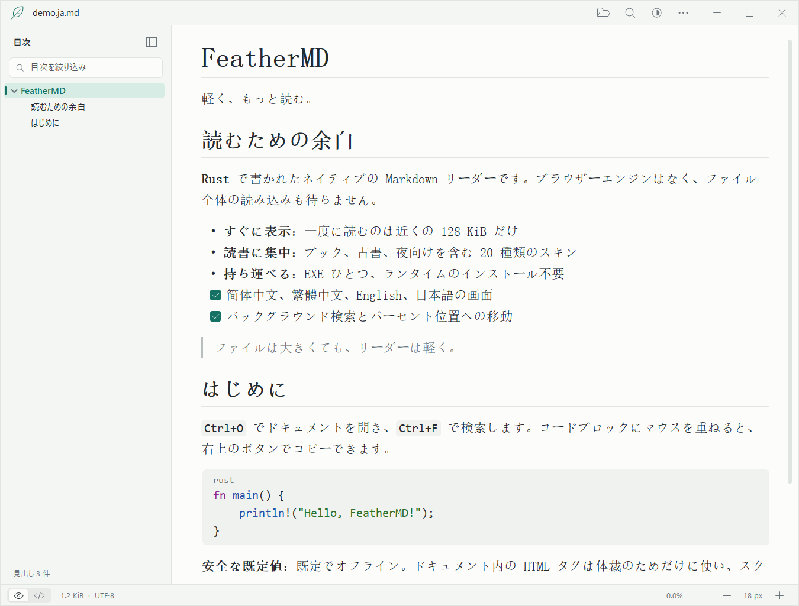

上部は高さ 34 px の静かなタイトル バーです。左には羽のマークとドキュメント名だけ、右の**開く / 検索 / 外観 / その他**の 4 つのアイコンは同じ大きさと線の太さで、マウスを重ねると淡い角丸の下地と名前、ショートカットを表示します。ウィンドウのボタンは列全体が反応し、閉じるボタンは赤くなります。プレビューとソースを切り替える**目 / コード**のスイッチはステータスバーの左端にあります。アイコンは GDI+ のアンチエイリアス付きベクターで、直線はピクセル格子に揃え、曲線はなめらかです。

**外観はボタンひとつ**（半分塗った円）：クリックするとライト / ダーク / システム、4 行目の「その他のスキン…」で設定の 20 種類のスキンを開きます。**Ctrl+T** でも開け、矢印キーか Tab で選んで Enter で確定、Esc でキャンセルします。

**本文を右クリック → 編集**（Ctrl+E）：選んだ編集アプリで現在のドキュメントを開きます。FeatherMD 自身は読み取り専用のままで、保存後に F5 を押すと同じ位置で再読み込みします。

**ワンクリックでコピー**：コードブロック、引用、表にマウスを重ねると、右上に「コピー」ボタンが出ます。コードはフェンスを除いた原文、表はタブ区切りのセルとしてコピーします。

目次の開閉ボタンは目次の側にあります。表示中は「目次」見出しの右、隠すと本文の左端です。ドキュメントを開いていないときは空の目次欄を出しません。

新しい設定はシステムのテーマに従い、Windows のアプリの色が変わると更新します。ライトやダークを明示的に選んだ場合は上書きしません。スキンを切り替えても読んでいる位置は変わらず、表示モードとスキンは再起動後も保持されます。

このあとのスクリーンショットは主に简体中文の画面ですが、すべての画面が日本語でも表示できます（[表示言語](#表示言語)を参照）。

<details>
<summary>その他のプレビュー：ダークでの読書、目次を隠した画面、ようこそ画面</summary>

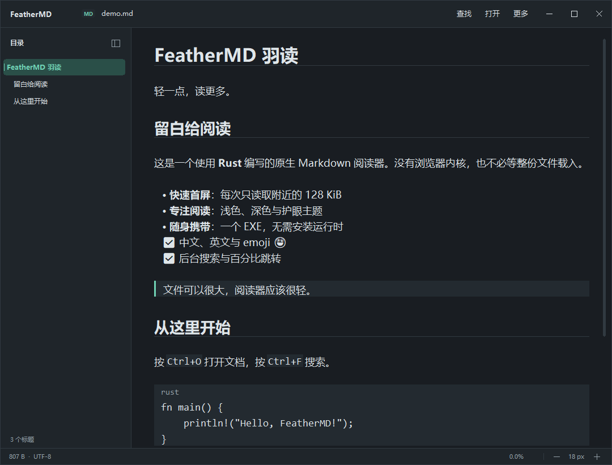

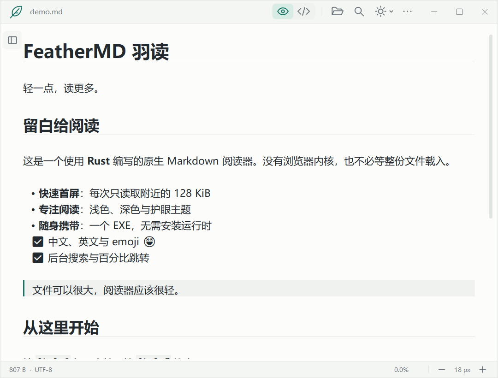

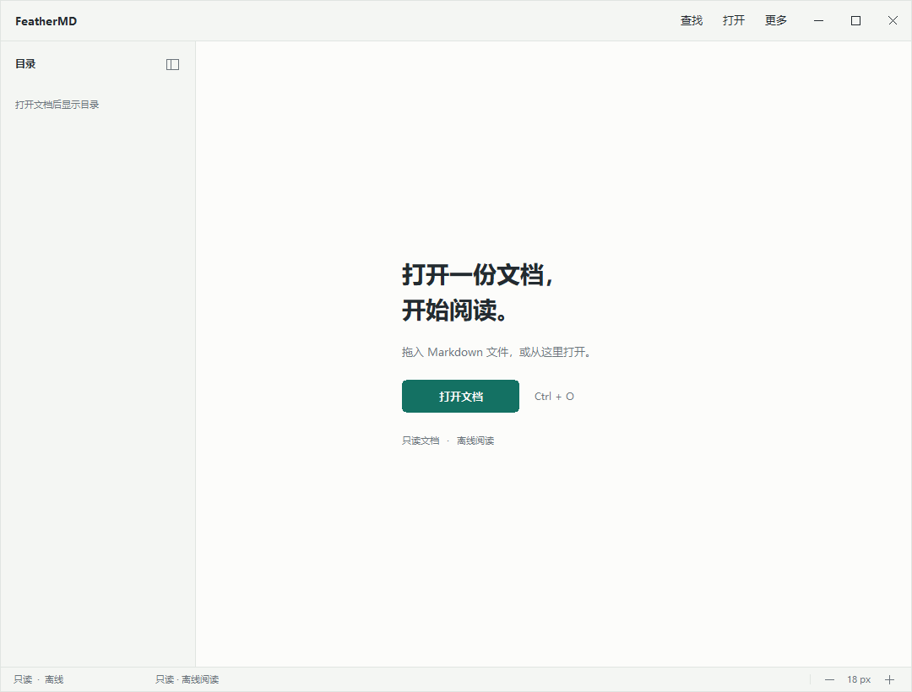

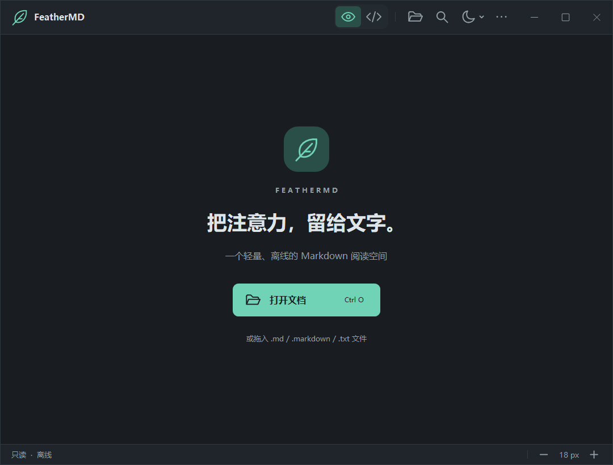

</details>

## なぜ作ったか

Markdown を開くために、まずブラウザーを起動する必要はありません。

FeatherMD は Win32 と GDI/GDI+ で動きます。Electron、WebView、JavaScript、テレメトリはなく、既定でオフラインです。GitHub Releases には更新確認を有効にするか手動で確認したときだけアクセスし、Web の画像は個別にクリックして確認した場合だけ取得します。v0.1.13 の Windows x64 EXE は約 **1.11 MiB**（4 つの表示言語、コードの色分け、ローカル画像のデコードを含む）で、.NET や VC++ ランタイムなどのインストールは不要です。

**大きなファイルも、全体を読み込んでから表示するわけではありません。** 一度に読むのは近くの 128 KiB だけで、読み込みと検索はバックグラウンドで行い、描画するのは見えている行だけです。ファイル全体の大きさで最初の画面に必要なメモリが決まることはありません。

## 使い方

1. Releases から **FeatherMD.exe** をダウンロードし、好きなフォルダーに置いてダブルクリックします。
2. Markdown、テキスト、ログのファイルをウィンドウにドロップするか、**Ctrl+O** を押します。
3. 目次の見出しをクリックするとその位置へ移動します。「目次」見出しの右のボタンで隠し、本文左端のボタンで再表示します。**Ctrl+B** でも切り替えられ、状態は保存されます。
4. ステータスバー左端の目 / コードのスイッチでプレビューとソースを切り替え（Ctrl+R）、上部の外観ボタンでスキンを選びます。三点の「その他 → 設定…」（Ctrl+,）でスキン、不透明度、フォントとサイズ、画像を表示するかどうか、既定の編集アプリ、表示言語を変更できます。折り返しと読書幅も「その他」にあります。
5. **その他 → FeatherMD について**（F1）でバージョン、ショートカット、読み方の説明を確認でき、GitHub のプロジェクト ページや Afdian（作者の支援）へも移動できます。外部リンクは確認してから既定のブラウザーで開きます。
6. **その他 → 更新を確認…** で新しいバージョンを手動で確認します。設定の「更新」ページで起動時の自動確認も選べます（既定はオフ）。
7. **その他 → 表示言語 / Language…** で表示言語を切り替えます。保存するとすぐに反映されます。

Windows 10（1607 以降）/ Windows 11 の **x64** に対応しています。実機で確認しているのは Windows 11 x64 で、そのほかのバージョンは個別には確認していません。インストーラーはなく、管理者権限も不要です。コード署名証明書はまだないため、Windows SmartScreen が発行元不明と警告することがあります。保護をオフにせず、入手元と SHA-256 を確認してください。

### プレーン テキストとログ

Markdown のほか、**.txt のプレーン テキスト**と **.log などのログ**もそのまま読めます。目次は形式ごとに変わります。

| 形式 | 判定 | 本文 | 目次 |
| --- | --- | --- | --- |
| Markdown | .md / .markdown / .mdown / .mkd | レイアウトしたプレビュー | `#` 見出し |
| プレーン テキスト | .txt などのテキスト ファイル | 各行をそのまま表示し、行頭の字下げと空行を保って折り返し | 章：`第3巻`、`第十二章`、`第3話`、`第2節`、`序章` / `番外`、`Chapter 12` / `Part One`、下線（`===` / `---`）付きの見出し。章のない文書は `一、`、`（一）` の番号 |
| ログ | .log、ローテーションした `app.log.1`、.out。行頭の多くが時刻の .txt もログとして読みます | 等幅フォント、時刻は淡色、`ERROR` / `FATAL` は赤、`WARN` は琥珀色、ANSI カラー コードは表示しません | **時刻の索引**：日付 → 時間帯ごとにまとめ、時間帯ごとのエラーと警告の数を表示。エラーを含む時間帯は赤で、クリックするとその最初の行へ移動。時刻のないログ（ビルド出力など）はエラー行を一覧します |

時間帯の長さはログの期間に合わせて自動で選び（1 分〜1 週間）、目次は最大 240 件です。ISO 8601、log4j / Spark、syslog、Android logcat、glog、Nginx / Apache のアクセス ログ、logfmt / JSON の時刻と `level=error` などの一般的な書き方を認識します。ログの目次はバックグラウンドで 256 KiB ずつ**ファイル全体**を調べ、大きなファイルでは進み具合を表示し、別のファイルを開くか目次を隠すと中止します。本文が読むのは引き続き近くの 128 KiB だけです。実測では 1 GiB・約 1070 万行のログの索引が約 1.9 秒、25 MB・3000 章の小説の章の認識が約 22 ms でした（ウォーム キャッシュ、[PERFORMANCE.md](docs/PERFORMANCE.md) 参照）。

**UTF-8 でないファイル**は Windows のシステムの従来のコード ページで読みます。日本語の Windows では Shift-JIS、簡体字中国語では GB18030（GBK 互換）、繁体字中国語では Big5 です。使った文字コードはステータス バーに表示し、検索もその文字コードで行います。UTF-8 のファイルは影響を受けません。ソース表示（Ctrl+R）は原文を表示し、コピーはタブを保ちます。

### 本文のレイアウト、コードの色分け、HTML タグ

既定の文字サイズは 16 px、本文の行の高さは約 1.6 倍です。空行は 1 行より少し短い段落の間隔になり、見出しは下より上を広く空け、レベル 1 と 2 の見出しには細い線を引きます（折り返した見出しは最後の行の下だけ）。折り返したリスト項目は項目の文字にそろい、タスク リストはチェックボックスで、引用は灰色の縦線と補助色の文字、表の本文行は薄い縞模様になります。

コードブロックは角の丸い下地に本文より少し小さい等幅フォントで表示し、左上に言語名を出します。**コードの色分け**は Rust、C/C++、C#、Java/Kotlin/Scala、Swift、Go、JavaScript/TypeScript、Python、Ruby、PHP、Lua、SQL、シェル、PowerShell、バッチ ファイル、JSON、YAML、TOML/INI、Dockerfile、CSS、HTML/XML、diff に対応します。キーワード、型、関数名、文字列、数値、コメントなどの色はスキンに合わせて調和させ、複数行にわたるブロック コメントや文字列も色を保ちます。インライン コードと `<kbd>` のキーは角の丸い小さな下地になります。

よく使う **HTML タグ**はレイアウトとして表示します：`<p>`、`<h1>`～`<h6>`、`<br>`、`<hr>`、`<b>`/`<strong>`、`<i>`/`<em>`、`<u>`、`<s>`/`<del>`、`<code>`、`<kbd>`、`<mark>`、`<sub>`/`<sup>`、`<a>`、``、`<blockquote>`、`<ul>`/`<ol>`/`<li>`、`<pre>`、`<div>`/`<span>`/`<center>`、`<details>`/`<summary>`（常に展開）、`align` 属性と `text-align` スタイルによる中央・右寄せ、よく使う文字参照。多くの README の冒頭にある `<h1 align="center">` も目次に入ります。`<script>`、`<style>`、`<iframe>` などの中身は表示も実行もしません。タグはレイアウトを変えるだけで、何かを実行することはありません。

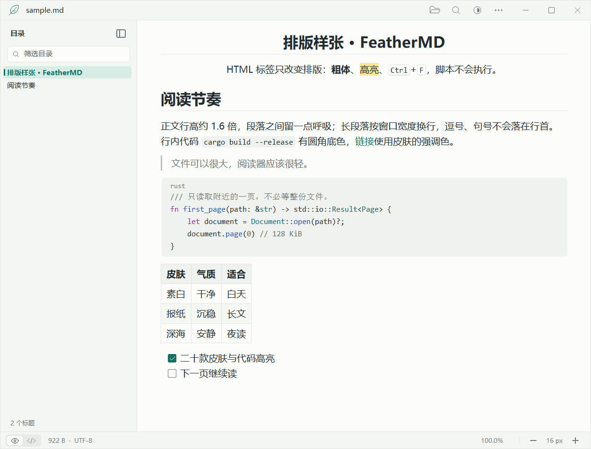

### スキンと不透明度

**その他 → 設定… → 外観**：20 種類のスキンがあり、明るいものが先、暗いものが後に並びます。システム、ライト、**ペーパー**（真っ白な紙）、ミスト、スカイ、目にやさしい、**ブック**（リネンの机に置いた温かい白の紙）、**古書**（生成りの紙、墨色の本文、朱色のアクセントと二重の罫線）、**新聞紙**（温かみのある灰色の紙と紺のリンク）、セージ、さくら、**ライラック**、ダーク、**夕暮れ**（ダークより柔らかい夜向けの灰色）、**極夜**（冷たいスレートブルー）、ミッドナイト、**深海**（深い青緑）、**バイオレット**、**モカ**（温かい茶色と琥珀色）、ブラック（OLED 向け）。選ぶとすぐに読書ウィンドウでプレビューし、矢印キーでカードを移動できます。「キャンセル」か Esc で元に戻り、保存した選択は再起動後も保持されます。コードの色分けもスキンごとに調和させています。

**ウィンドウの不透明度**は 30%～100%、5% 刻みで、ドラッグか矢印キーで調整します。適用されるのは読書ウィンドウだけで、設定ウィンドウは不透明のままです。100% のときはレイヤード ウィンドウを使いません。すべてのスキンで本文と背景のコントラストは 9.8:1 以上、補助テキストは 4.3:1 以上、リンクは 4.5:1 以上です（単体テストあり）。

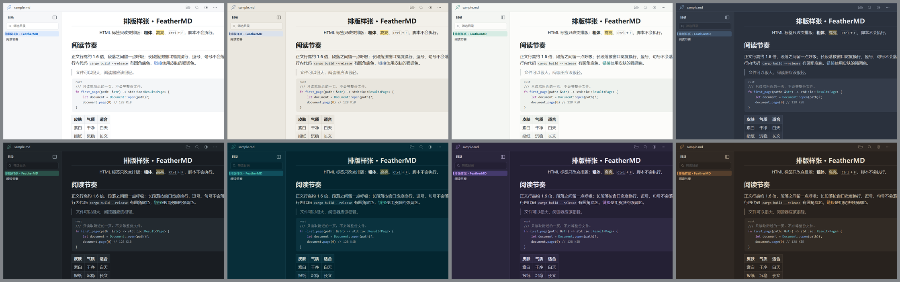

<details>
<summary>スキンの設定と、ブック / 古書での読書画面</summary>

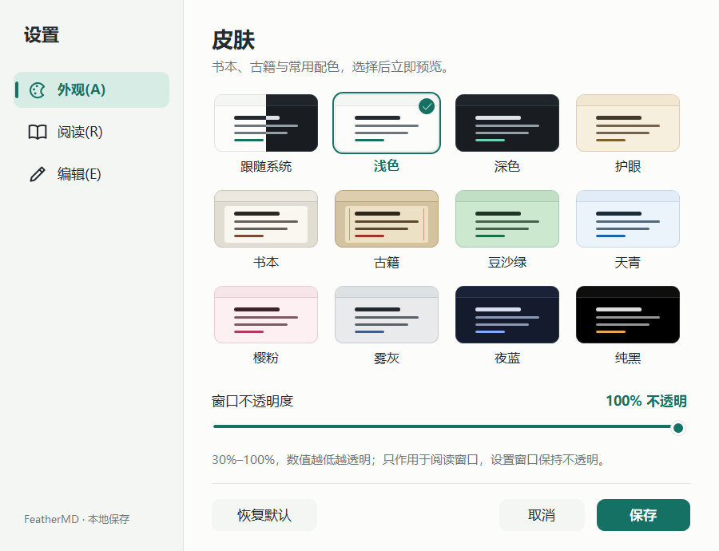

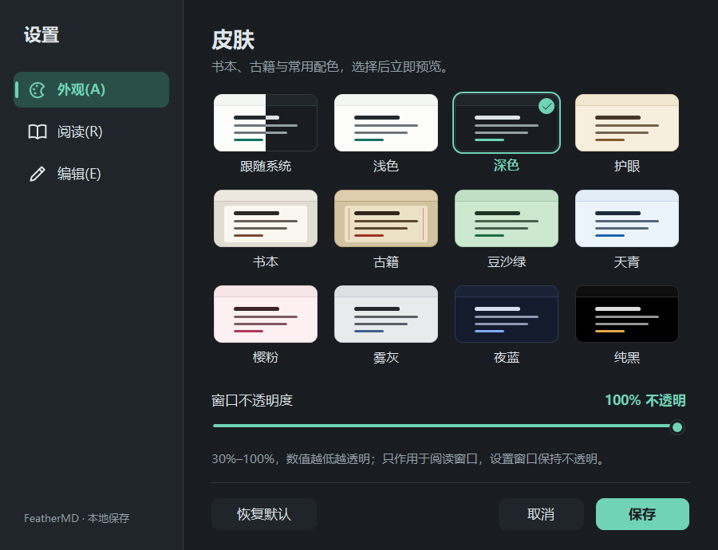

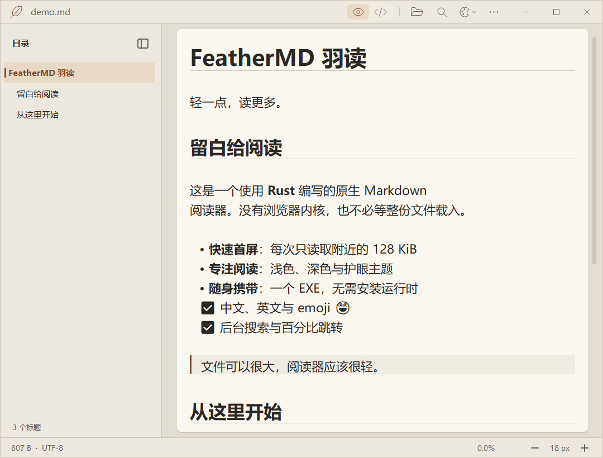

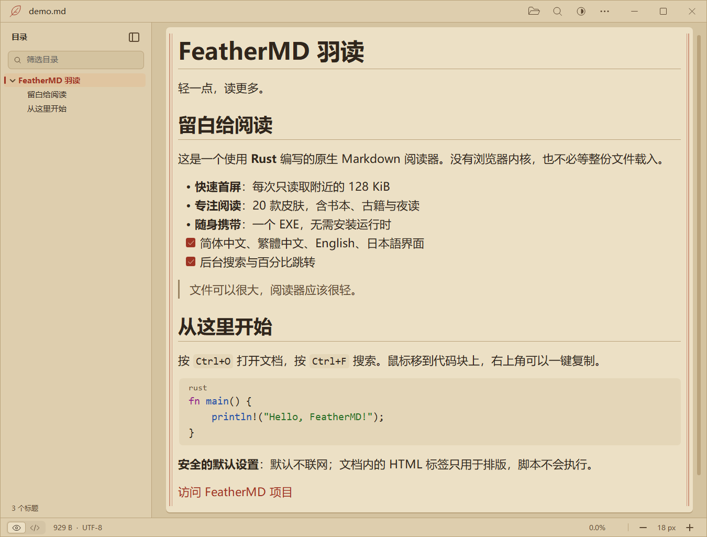

</details>

### 右クリックで編集と既定の編集アプリ

FeatherMD は読み取り専用です。変更したいときは本文を**右クリック → 編集**するか **Ctrl+E** を押すと、現在のドキュメントを引用符付きの 1 つの引数として編集アプリに渡します。保存したらリーダーで **F5** を押すと、同じ位置で再読み込みします。右クリック メニューにはコピー、このページをすべて選択、検索、再読み込みもあり、**Shift+F10** やメニュー キーでも開けます。

**その他 → 設定… → 編集**で既定の編集アプリを選びます。

- **システムの既定**：Windows がそのファイルの種類に登録した「編集」を使います。登録がなければシステムのメモ帳を使います。
- **メモ帳**、および自動検出した VS Code、VSCodium、Cursor、Typora、MarkText、Notepad++、Sublime Text、Zed、EmEditor（決まったインストール場所と App Paths の登録だけを確認し、ディスクは走査しません）。
- **参照…** でローカル ドライブ上の任意の .exe を選べます。ドライブ文字で始まる絶対パスだけを受け付け、FeatherMD 自身は選べません。

編集アプリが見つからないときはそのことを知らせ、すぐに選び直せます。この設定で Windows の既定のアプリやファイルの関連付けが変わることはありません。

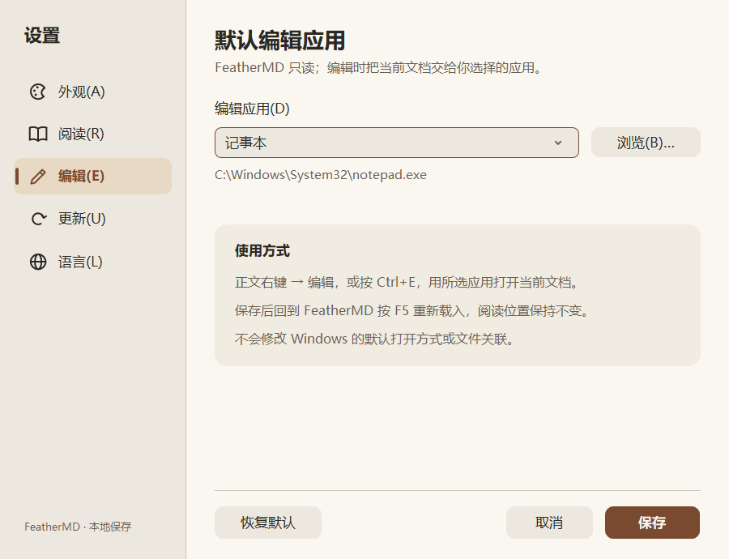

### コード、引用、表をワンクリックでコピー

プレビューでコードブロック、引用、表にマウスを重ねると、右上に**コピー**ボタンが出ます。クリックするとブロック全体をコピーします。

- **コードブロック**：ファイル内の原文をコピーします。```` ``` ```` のフェンス行は含めず、インデントされたコードはインデントを 1 段外します。タブはそのまま、行の区切りは CRLF です。
- **引用**：画面に表示されている文字をコピーします。画面上で折り返した行に改行は入りません。
- **表**：各行をタブ区切りのセルとしてコピーします。表計算ソフトにそのまま貼り付けられます。

長いコードブロックをスクロールしても、ボタンは見えている部分の上端にとどまるので、先頭まで戻る必要はありません。本文より幅の狭い表では、見出し行を隠さないよう表の右側に表示します。コピーするとボタンが約 1.5 秒チェックマークになり、ステータスバーに何をコピーしたかを表示します。ブロックが読み込み済みのページ（約 128 KiB）を超える場合は読み込み済みの部分だけをコピーし、そのこともステータスバーに表示します。ソース表示にはコピーボタンはありません。文字単位で選択してコピーしてください。

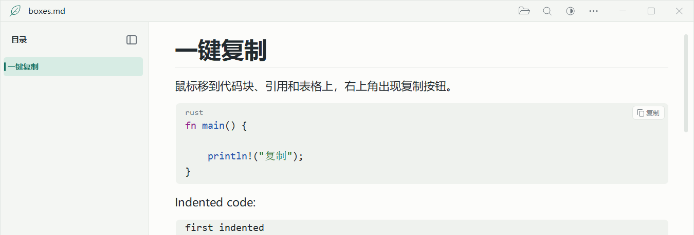

### 画像の表示

**その他 → 設定… → 読書 → 画像を表示**は**既定でオフ**です。オフのとき、ローカル画像は「[画像: 代替テキスト]」と表示し、画像を自動で読み込みません。

オンにすると**このコンピューター上の画像**を自動表示します。相対パスはドキュメントのあるフォルダーが起点で（`/assets/a.png` も同じ）、ドライブ文字で始まる絶対パスや `file:///C:/…` も使えます。形式は拡張子ではなくファイルの中身で判断し（PNG、JPEG、GIF、BMP、TIFF、ICO）、JPEG は EXIF の向きに従って正しい向きに直し、透明な部分はスキンの背景が見え、GIF は最初のフレームを表示します。画像は CSS ピクセルとして DPI に合わせて拡大縮小し、`` で大きさを指定でき、本文の幅を超えると縮め、読書領域より高くはなりません。画像だけの行（ロゴ、スクリーンショット、バッジ）も段落内の小さなアイコンも表示し、リンク付きの画像はクリックできます。

**Web 画像の手動読み込み（v0.1.10）：** プレビューの HTTP(S) 画像の代替テキストをクリックし、URL を確認すると、その URL の画像だけを読み込みます。「画像を表示」がオフでも使えます。失敗時は再試行でき、同じ URL はメモリ内の画像を共有します。他の画像は自動取得せず、Cookie・認証情報・参照元を送信せず、ファイルも保存しません。画像サイトには IP アドレスが伝わります。F5、文書の開き直し、再起動後は再確認が必要です。画像を直接返す HTTP(S) URL のみ対応し、転送先、SVG/WebP、表のセル内の画像には未対応です。

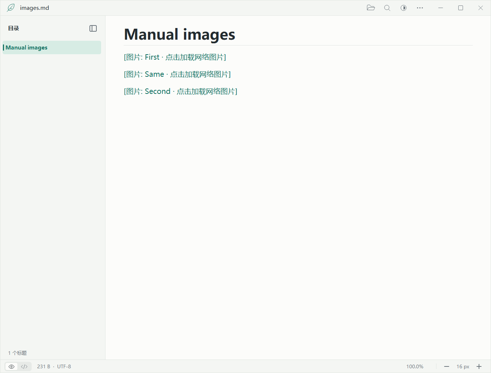

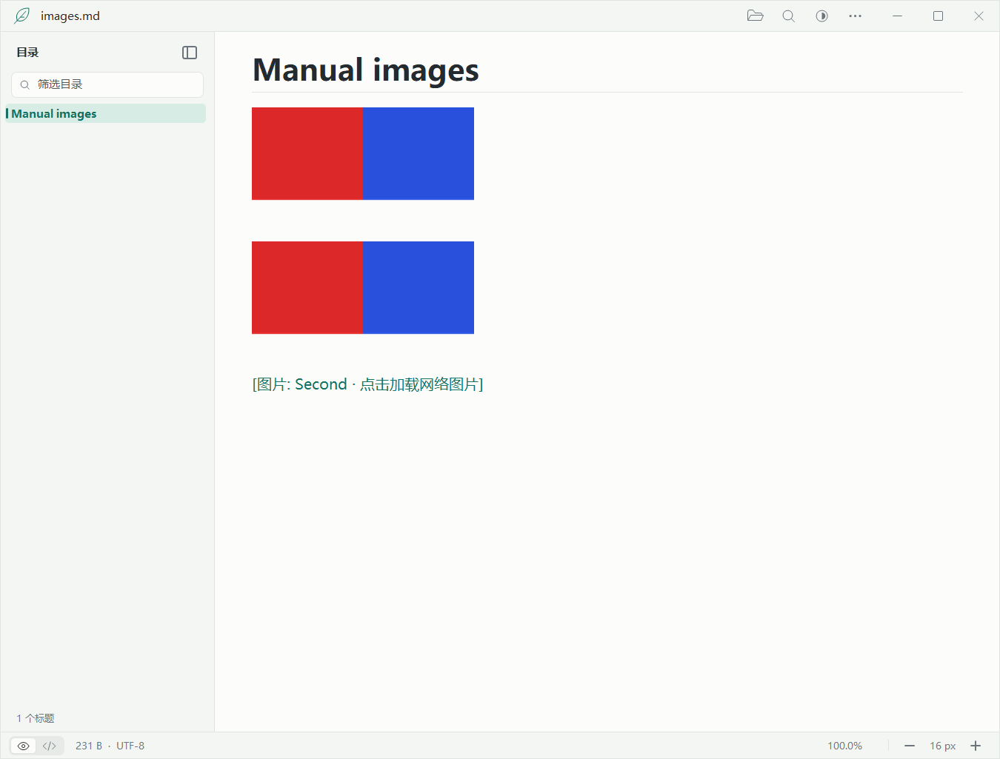

次のものは**読み込まず**、その場所に代替テキストと理由を表示します：HTTP(S) が明示されていないアドレス（`//ホスト/…` など）、シンボリック リンクやジャンクションの先のファイル、ネットワーク ドライブと共有フォルダー、デバイス パス、ダウンロードされていないオンライン専用の OneDrive ファイル、見つからないファイル、SVG や WebP など未対応の形式、32 MiB、3200 万ピクセル、一辺 16384 px を超える画像。

読み込みとデコードはバックグラウンドのスレッドで行うので、ページが待たされることはありません。1 ページに表示する画像は最大 64 枚、デコード済みの画像は合計約 160 MiB までで、前のページの画像から解放します。オフにするとすべての画像をすぐに解放します。

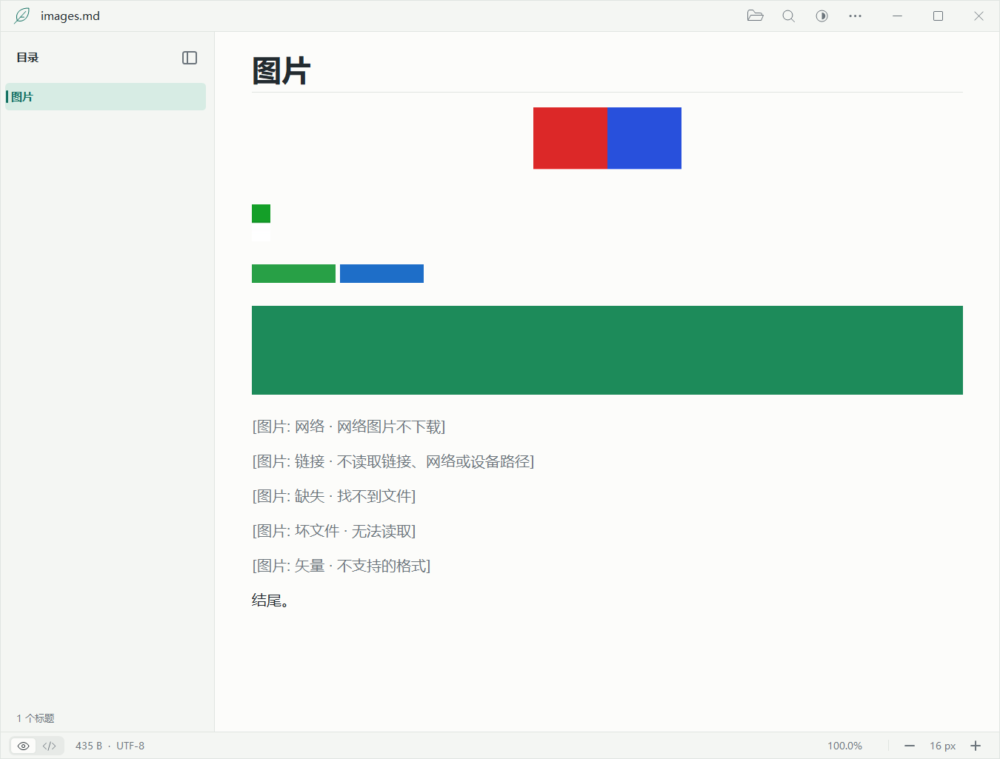

### 表示言語

画面は **简体中文（簡体字中国語）、繁體中文（繁体字中国語）、English（英語）、日本語** に対応しています。既定では Windows の表示言語に従います。台湾、香港、マカオは繁體中文、そのほかの中国語圏は简体中文、日本語は日本語、翻訳のない言語では英語になります。

**その他 → 表示言語 / Language…**（設定の「言語」ページ）で言語を選び、保存するとメニュー、ボタン、メッセージ、ダイアログがすぐに切り替わります。再起動は不要です。言語ごとに、その地域の字形に合った UI フォント（Microsoft YaHei UI、Microsoft JhengHei UI、Yu Gothic UI）を使います。ドキュメントの内容と読書用フォントは変わりません。本文を日本語の字形で読みたい場合は、**設定 → 読書**で Yu Gothic UI などの日本語フォントを選んでください。この説明は [简体中文](README.md)、[繁體中文](README.zh-TW.md)、[English](README.en.md) でも読めます。

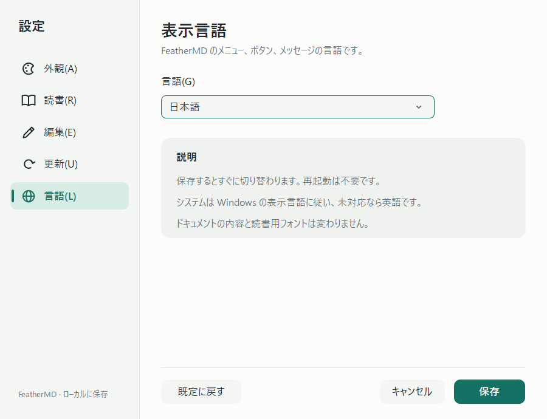

### 表

GitHub 形式のパイプ表（見出し行と `| --- | :-: | --: |` の区切り行）は、見出しに背景色と罫線のある表として表示します。セル内では太字、インライン コード、リンクが使え、区切り行のコロンで左揃え、中央揃え、右揃えを指定できます。

列幅はウィンドウに合わせて自動で調整します。収まるときは各列が内容の幅を保ち、収まらないときは最も広い列から狭め、短い列はそのままにします。セル内は単語または CJK 文字の単位で折り返し、読点や句点で行が始まることはありません。ウィンドウを狭めたり、目次を隠したり、文字サイズを変えたりするとすぐに組み直します。

列が多く、読める最小の幅（約 6 文字）でも収まらない場合は、その表だけを横にスクロールします（下部のスクロールバー、Shift+ホイール、左右の矢印キー）。本文や収まる表は動きません。折り返しをオフにすると、表は内容の幅を保ち、本文と一緒に横スクロールします。

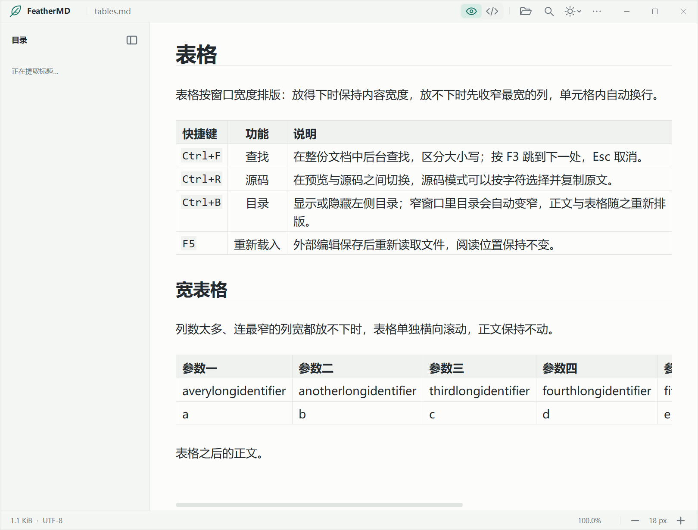

### 文字単位の選択

プレビューでもソース表示（Ctrl+R）でも、マウスのドラッグで文字単位に選択できます。ダブルクリックで単語を選択、Shift+クリックで選択範囲を広げ、本文の上下の端より外へドラッグすると自動でスクロールしながら選択を続けます。Ctrl+A で読み込み済みのページを選択、Esc で選択を解除し、Ctrl+C か右クリックの「選択したテキストをコピー」でコピーします。選択していないときは表示中の内容をコピーします。

- **プレビュー**は画面に表示された文字をコピーします。同じ段落の折り返した行は 1 行につながり（折り返しで取り除いた空白は戻します）、段落の区切りは CRLF です。表のセルの文字も文字単位で選択でき（ダブルクリックでセル内の単語を選択）、セルの間はタブ、行の間は CRLF で区切るので、行全体はタブ区切りのセルとしてコピーされます。画像は代替テキストをコピーします。文字サイズの変更、ウィンドウのサイズ変更、画像の読み込みのあとも、選択した文字は変わりません。
- **ソース表示**はファイル内の**原文**をコピーします。タブはタブのまま、漢字や絵文字が途中で切れることはなく、行の区切りは CRLF で、画面上で分割した非常に長い行に余分な改行は入りません。

選択範囲が読み込み済みのページ（約 128 KiB）を超える場合は読み込み済みの部分だけをコピーし、ステータスバーで知らせます。コードブロック、引用、表をひとつだけコピーするなら、右上のコピーボタンが便利です。

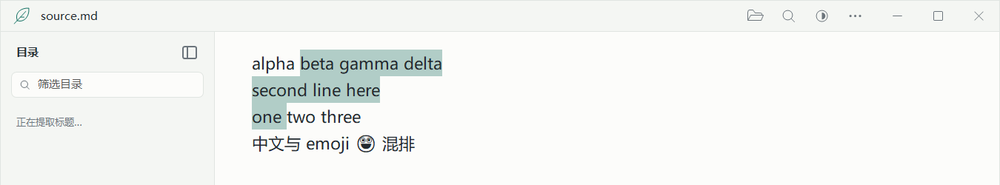

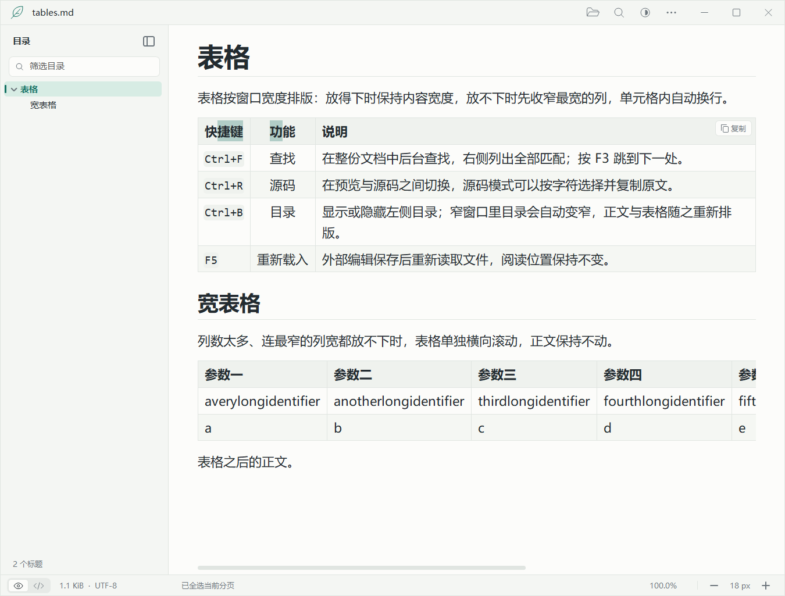

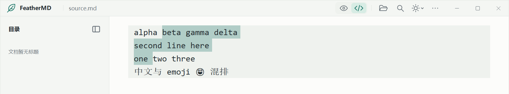

### 更新の確認

更新元はこのプロジェクトの [GitHub Releases](https://github.com/Lianzy-Baimiao/FeatherMD/releases) です。

- **手動で確認**：その他 → 更新を確認… で設定の「更新」ページを開き、すぐに確認します。結果は「最新バージョンです」、「新しいバージョン … があります」（リリース名と公開日付き）、または確認できなかった理由（ネットワーク、プロキシ、GitHub のアクセス頻度の制限など）です。
- **起動時に自動確認**：「更新」ページでチェックを入れて保存します。**既定はオフ**です。オンにすると起動から約 3 秒後にバックグラウンドで確認し、24 時間に最大 1 回です。失敗しても通知せず、次回の起動時に再試行します。
- **新しいバージョンがあるとき**は、上部の「その他」ボタンに小さな点が付き、メニュー項目が「新しいバージョン vX.Y.Z…」になります。更新すると消えます。「配布ページへ…」は確認してから既定のブラウザーでそのリリースのページを開きます。

確認は Windows 標準の WinHTTP による 1 回の HTTPS リクエストで、`api.github.com` の公開されたバージョン情報を読むだけです。システムのプロキシ設定と証明書の検証をそのまま使います。ドキュメントや設定などのデータは送信せず、ファイルを**自動でダウンロードしたりインストールしたりすることもありません**。自動確認がオフで「今すぐ確認」も押さなければ、FeatherMD は GitHub に接続しません。Web 画像は更新確認とは別に、1 枚ずつ確認したときだけ読み込みます。「更新」ページの「プライバシー…」で、プライバシーに関する説明全文をオフラインで表示できます（docs/PRIVACY.md として同梱）。

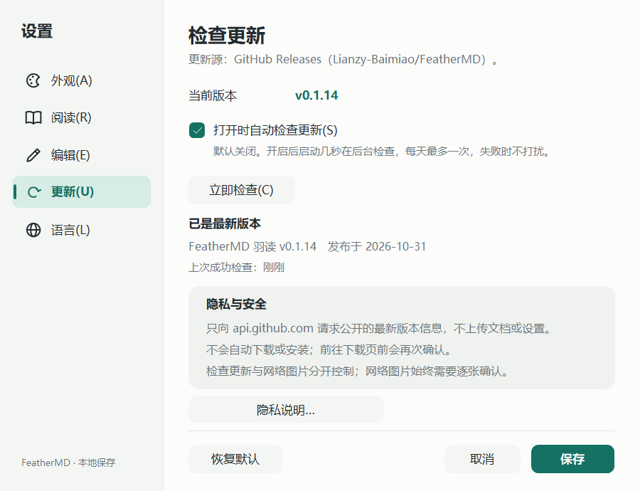

### フォントと既定のサイズ

**その他（…）→ フォントと既定のサイズ…**（設定の「読書」ページ）：インストール済みのフォントから選べ、欧文・和文どちらのフォントも使えます。既定のサイズは **12～36 px** で、プレビューを見ながら設定できます。「保存」で適用して記憶し、「キャンセル」か Esc では現在の設定を変えません。「既定に戻す」は保存するまでこのページの下書きだけを戻します。

本文のフォントは見出しにも使い、画面の文字はそのままです。ソース表示、コードブロック、インライン コードは等幅フォントのままです。フォントにない文字は Windows がほかのフォントで表示します。既定の文字サイズは 16 px で、既定の本文フォントは表示言語に従います（简体中文と English は Microsoft YaHei UI、繁體中文は Microsoft JhengHei UI、日本語は Meiryo）。表示言語を切り替えると一緒に変わり、ほかのフォントを選ぶとそのフォントを使い続けます。文字サイズは Ctrl+ホイールや Ctrl++ / Ctrl+- と同じ保存値を使うので、あとで開くドキュメントや再起動後も最後に保存したサイズになります。

上部とようこそ画面のアイコンは Windows GDI+ のアンチエイリアス付きベクター曲線と丸い線端で、DPI に合わせて描画します。アイコン フォント、画像のダウンロード、サードパーティのランタイムは使いません。

<details>
<summary>フォントの設定：ライトとダーク</summary>


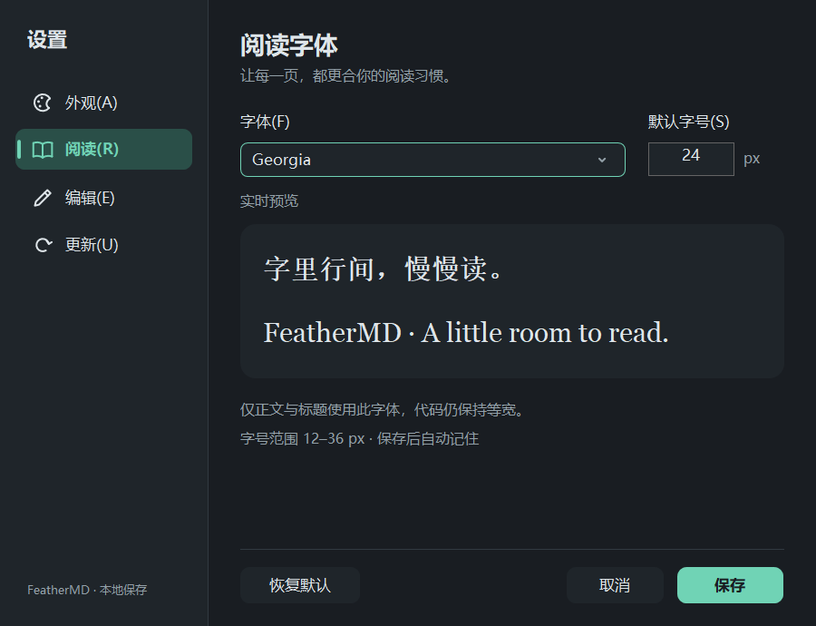

</details>

### バージョン情報とプロジェクトへのリンク

**その他 → FeatherMD について**（F1）：読書画面と同じ配色のネイティブ ウィンドウで、バージョン、GitHub のプロジェクト ページ、Afdian へのリンクがあります。「ショートカットと読み方」を開くと 2 列のショートカット（Ctrl+E 編集、Ctrl+, 設定、Ctrl+T 外観、Esc 選択解除を含む）と、ワンクリックのコピー、表のレイアウト、文字単位の選択、画像の表示、ページ単位のプレビューについての説明が表示されます。Tab、Enter、Esc で操作できます。ウィンドウは現在のスキンと表示言語に従います。

<details>
<summary>バージョン情報ウィンドウ：日本語（ライト）と简体中文（ダーク）</summary>

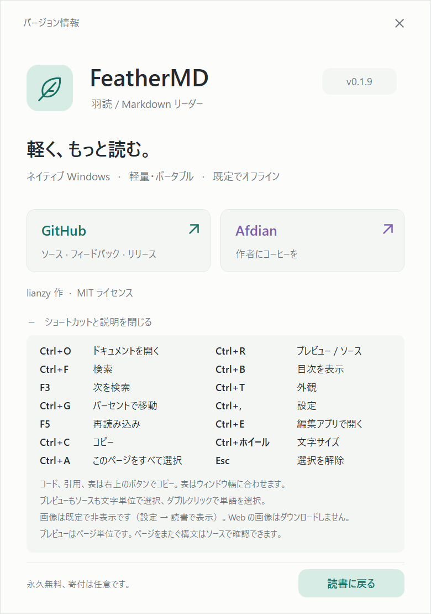

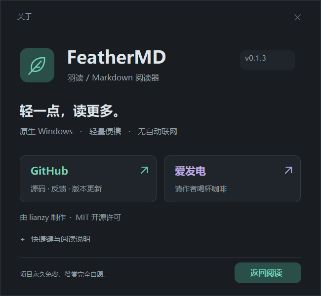

</details>

### 「プログラムから開く」と既定のアプリ

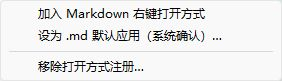

- まず EXE を**決まった場所**に置きます。
- **その他 → ファイルの関連付け → 「プログラムから開く」に追加（Markdown / テキスト / ログ）**で、現在のユーザーの「プログラムから開く」一覧に登録します。確認ダイアログも Windows の設定も開きません。
- .md をダブルクリックしたときに FeatherMD で開きたい場合は、**その他 → ファイルの関連付け → .md の既定のアプリにする（システムで確認）…** を選びます。登録したうえで Windows の既定のアプリの設定を開くので、**.md → FeatherMD** を選んでください。古い Windows では既定のアプリのトップページが表示されることがあり、その場合は .md で検索します。
- 一覧に FeatherMD が見つからないときは、**決まった場所にある新しい EXE** を実行しているか確かめてから、上の登録や既定にする操作をもう一度行い、既定のアプリのページを閉じて開き直します。アプリの一覧で FeatherMD を、ファイルの種類で `.md` を検索し、それでも表示されなければ「別のアプリを選択」から EXE を参照します。一覧に載っても、既定のアプリになったわけではありません。
- .md ファイルを右クリック → プログラムから開く → 別のプログラムを選択 → FeatherMD → 常に使う、でも設定できます。
- 登録する拡張子は .md / .markdown / .mdown / .mkd / .txt / .text / .log です。
- 「『プログラムから開く』の登録を削除…」は FeatherMD 自身の登録だけを削除します。

Windows 10/11 では既定のアプリをユーザーがシステムの画面で確認する必要があり、一般のデスクトップ アプリが黙って設定する方法はサポートされていません。そのため「プログラムから開く」への追加は確認なしで完了しますが、「既定にする」にはシステムでの確認が必要です。EXE を移動したら登録し直してください。登録を削除しても、ほかのビューアーが自動で既定になることはありません。

対応範囲と Microsoft のドキュメントは[ファイルの関連付けについて](docs/FILE_ASSOCIATIONS.md)（中国語）にあります。

### 目次と移動

- 独自のタイトル バー、枠、ウィンドウ ボタンを使い、独立したツール バーをなくして本文の領域を広く取っています。
- 折りたためる見出しの目次は単独でホイール スクロールでき、クリックした見出しへ移動します。目次はバックグラウンドで作るので、最初の画面の表示を遅らせません。
- 独自の縦横スクロールバーはドラッグとトラックでのページ送りに対応します。遠くまで素早くドラッグして戻っても、古いページの結果が読書位置を動かすことはありません。短いファイルでは不要なスクロールバーを隠します。
- End は最後の画面全体を表示し、最後の段落が長く折り返していても本当の末尾に届きます。PageUp / PageDown は実際の行の高さでページを送り、1 行を重ねて残すので、大きな見出しで読み飛ばすことはありません。キャッシュしたページをまたいで戻るときも長い段落の折り返し位置を保ち、選択していないときのコピーは実際に見えている行が対象です。

Markdown の目次は `#` から `######` までの見出しを表示し、コード フェンスの中は除きます。大きなファイルでも反応を保つため、Markdown の目次が調べるのは先頭の最大 **16 MiB**（プレーン テキストの章は先頭 256 MiB、ログの時刻の索引はファイル全体。「プレーン テキストとログ」参照）、表示する見出しは最大 **4096 件**で、上限に達すると目次の下に表示します。Setext（下線）形式の見出しは載りません。本文の読書と全文検索は目次の範囲に制限されません。再読み込み（F5）で目次を作り直します。

### ショートカット

| 操作 | ショートカット |
| --- | --- |
| ファイルを開く | Ctrl+O / ドラッグ アンド ドロップ |
| 目次の表示 / 非表示 | Ctrl+B / 目次の開閉ボタン |
| バックグラウンド検索（大文字と小文字を区別する原文検索） | Ctrl+F |
| 次の一致（末尾で先頭に戻る） | Enter / F3 |
| 検索をキャンセル / 検索バーを閉じる | Esc |
| バイト位置のパーセントで移動 | Ctrl+G |
| ファイルの先頭 / 末尾 | Home / End |
| スクロール | ホイール / ↑↓ / PageUp / PageDown / Space |
| 文字を大きく / 小さく | Ctrl+ホイール / Ctrl++ / Ctrl+- |
| ソース / プレビューの切り替え | Ctrl+R |
| 外観（ライト / ダーク / システム / その他のスキン） | Ctrl+T / 上部の外観ボタン |
| 設定（スキン、不透明度、フォント、編集アプリ、言語） | Ctrl+, |
| 既定の編集アプリで現在のドキュメントを開く | Ctrl+E / 本文を右クリック → 編集 |
| 右クリック メニュー | 右クリック / Shift+F10 / メニュー キー |
| 再読み込み（読書位置を保持） | F5 |
| 読み込み済みのページを選択 | Ctrl+A |
| 選択した内容をコピー（プレビューは表示どおりの文字、ソースは原文）、未選択時は表示中の内容 | Ctrl+C |
| コードブロック、引用、表をまるごとコピー | ブロックにマウスを重ねる → 右上の「コピー」 |
| 選択を解除 | Esc |
| 読書設定を既定に戻す | Ctrl+0 |
| 更新を確認 | その他 → 更新を確認… |
| 表示言語 | その他 → 表示言語 / Language… |
| ヘルプ | F1 |

マウスのドラッグによる選択は、プレビューでもソース表示でも**文字単位**です（ダブルクリックで単語、Shift+クリックで範囲を拡張）。プレビューの表のセルも同じです。折り返しがオフのときや表の幅が広すぎるときは、下部のスクロールバーか左右の矢印キーを使います。

### 設定ファイル

設定は既定で %APPDATA%\FeatherMD\settings.ini に書き込み、変更のたびに自動で保存します。ドキュメントそのものは常に読み取り専用です。スキン、不透明度、編集アプリはそれぞれ `theme`、`opacity`、`editor`、画像の表示は `images`（`true` / `false`、既定は `false`）、空の `font_family` は本文フォントが表示言語に従うことを示し、自動確認のオン / オフは `update_check`、前回成功した確認の時刻と見つかった最新バージョンは `update_checked`、`update_latest` として保存します。表示言語は `language`（`system`、`zh-CN`、`zh-TW`、`en`、`ja`、既定は `system`）です。無効な値は既定に戻り、BOM 付きの UTF-8 ファイルも読み込めます。

設定を持ち運びたい場合は、EXE と同じフォルダーに空の **FeatherMD.ini** を作ると、以後の設定はそのファイルに保存されます。単一ファイルで使うだけなら必要ありません。最近使ったファイルやドキュメントの本文が設定に書き込まれることはありません。

## 対応範囲と明確な制約

- ドキュメントは UTF-8 / UTF-8 BOM と、システムの従来のコード ページで読む UTF-8 以外のテキスト（Shift-JIS / GB18030 / Big5 など）に対応し、本文はシステムのフォントで表示できる Unicode（言語を問わず）です。画面の文字は简体中文、繁體中文、English、日本語に対応しています。
- 見出し、太字、斜体、取り消し線、インライン コード、コード フェンス（主な言語を色分け）、引用、リスト、タスク リスト、区切り線、Web リンク、GitHub 形式の表（ウィンドウ幅に合わせて自動で組む）、よく使う HTML タグ。
- 画像は既定で代替テキストを表示します。「画像を表示」はローカル画像の自動表示のみを制御し、Web の画像は個別にクリックして確認すると取得します。
- HTML はレイアウトのためだけに使い、スクリプトの実行や外部リソースの自動読み込みはしません。未対応のタグと CSS は無視します。開けるのは http/https のリンクだけで、確認してから開きます。
- **これはメモリの少ないページ単位のプレビューで、完全な CommonMark/GFM のブラウザー レンダラーではありません。** 表以外は物理行の単位で組むため、行をまたぐ強調、Setext 見出し、複雑な入れ子（リスト内の表など）、文書全体の参照リンクなどは仕様どおりに表示されないことがあります。
- 先頭以外から始まるページでは、状態を復元するためにファイル全体を走査しません。ページをまたぐコード フェンスやリストの文脈が不完全になることがあり、ステータスバーで知らせます。ページが表の途中から始まり見出し行が見えない場合、その部分は見出しのない表として表示します。正確な原文が必要なときはソース表示に切り替えてください。
- 非常に長い 1 行は最大 4096 バイトの安全な Unicode の断片に分け、1 つの段落で UI が止まらないようにします。
- UTF-16/UTF-32 の BOM 付きドキュメントは、先に UTF-8 へ変換するよう明示します。そのほかの無効な UTF-8 バイトは代替文字で表示して知らせます。ファイルを勝手に書き換えることはありません。
- 全文検索は順にデータを読む必要があるため、速さは機器によって変わります。検索はキャンセルできます。ネットワーク ドライブ、HDD、ファイルのロック、システムの負荷も速さに影響します。
- 独自に描画する本文は、まだスクリーン リーダー向けの完全な意味情報を持ちません。HTML は行ごとに処理するため、複数行にまたがるひとつのタグ、表のタグ（`<table>` は「·」で区切った文字の行として表示）、深い入れ子はブラウザーと同じには表示されないことがあります。表のセル内の画像は代替テキストを表示します。

- プレーン テキストの章とログの時刻・レベルは一般的な書き方で認識します。完全なログ形式の解析器ではなく、認識できない時刻は時刻の索引に入りません。従来のコード ページのテキストで、改行も ASCII 文字もない非常に長い段落の途中からページが始まると、1 文字ずれることがあります。

**「どんなサイズでも一瞬で完全に描画する」とは約束しません。** 目標は、読み込み量に上限があること、最初の画面が速いこと、操作に反応し続けることです。

## 実測の概要

初版 v0.1.0 の基準：手元の Windows 11 x64、Release ビルド、ウォーム キャッシュ、1 GiB の実体の UTF-8 Markdown。

- バックグラウンドでの読み込みと Markdown の解析による最初のページ：中央値 **1.05 ms**（30 回、GDI のレイアウトは含みません）。
- 非表示の実ウィンドウでのテストで、起動から最初のページのレイアウトまで約 **75 ms**（1 回、コールド スタートの保証ではありません）。
- テスト終了時のプライベート メモリは約 **7.1 MiB**、ワーキング セットは約 **26.4 MiB**（システムの GUI DLL を含む）。
- 100 GiB の**スパース ファイル**で先頭、末尾、ランダムな読み込みを確認しました。これは 100 GiB の実際の Markdown を走査したという意味ではありません。

詳しい方法、数値、制約は [PERFORMANCE.md](docs/PERFORMANCE.md)（中国語）にあります。

v0.1.1 で同じ 1 GiB のファイルを測り直し、最初のページのレイアウトは 59.60 ms（ウォーム キャッシュで 1 回）でした。詳しくは性能の記録を参照してください。回ごとの揺れを全般的な性能向上とは解釈していません。

## ソースからのビルド

Rust stable と、Visual Studio Build Tools の「C++ によるデスクトップ開発」/ Windows SDK をインストールし、x64 Developer PowerShell で実行します。

~~~powershell
cargo +stable-x86_64-pc-windows-msvc test
cargo +stable-x86_64-pc-windows-msvc clippy --all-targets -- -D warnings
cargo +stable-x86_64-pc-windows-msvc build --release
~~~

生成物は target/release/feathermd.exe です。MSVC の静的 CRT の設定は .cargo/config.toml にあります。ソースのパスに日本語や中国語が含まれていてもビルドできます。windres のない GNU ツールチェーンはおすすめしません。

~~~powershell
# デスクトップを邪魔しない非表示ウィンドウのテスト：スキン、実入力での検索、パーセント移動、GDI リソース、終了
./scripts/ui-smoke.ps1
./scripts/navigation-smoke.ps1
./scripts/navigation-smoke.ps1 -Shape wrapped -Output ./test-artifacts/navigation-wrapped
./scripts/scrollbar-smoke.ps1
./scripts/window-smoke.ps1
./scripts/settings-smoke.ps1
# 表のレイアウト、横スクロール、コピーボタン、プレビューとソースの文字単位の選択（コピー内容はテスト用の経路で読み、クリップボードは変更しない）
./scripts/table-smoke.ps1
# ローカルの画像：既定でオフ。オンのときのサイズ、EXIF の向き、透明、バッジ、リンク、ジャンクションの拒否と理由の表示（画像はテストが生成）
./scripts/image-smoke.ps1
# 4 つの表示言語のすべての画面：文字が切れないこと、保存ですぐに切り替わること
./scripts/i18n-smoke.ps1
# 編集と更新のテストは代わりの編集アプリと、ループバックで動く GitHub API の代わりを使い、ネットワークにはアクセスしない
cargo +stable-x86_64-pc-windows-msvc build --release --example editor_probe --example update_server
./scripts/editor-smoke.ps1
./scripts/update-smoke.ps1

# 1 MiB / 64 MiB / 1 GiB の実体のテスト ファイルを作成（合計約 1.1 GiB）
./scripts/make-fixtures.ps1
cargo +stable-x86_64-pc-windows-msvc run --release --example bench -- test-artifacts/fixtures/1073741824.md 30
~~~

中核の読み込み、解析、設定のロジックは Linux でもテストでき、GUI は Windows 専用です。テストでは 100 GiB のスパース ファイルを作成して削除します。実際の使用量はわずかですが、スパース ファイルに対応したファイル システムが必要です。

## ライセンス

[MIT](LICENSE)。依存ライブラリのライセンスは [THIRD_PARTY_NOTICES.md](THIRD_PARTY_NOTICES.md) にあり、EXE にも同梱しています。「その他 → 同梱ライセンスを書き出す…」で保存できます。

## プロジェクトと支援

FeatherMD は無料のオープンソースで、広告はありません。問題の報告や改善への参加は [GitHub のプロジェクト ページ](https://github.com/Lianzy-Baimiao/FeatherMD)へどうぞ。

読書が少しでも軽くなったら、[Afdian](https://ifdian.net/a/lianzy) で作者にコーヒーを 1 杯ごちそうしてください。支援は完全に任意で、機能には一切影響しません。アプリの「その他 → FeatherMD について」にも入口があります。
