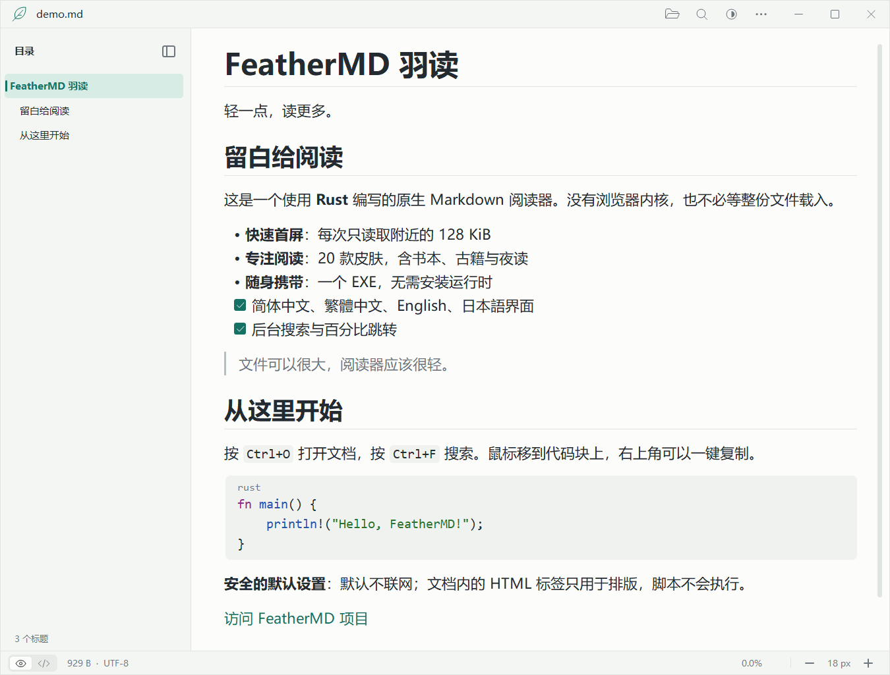
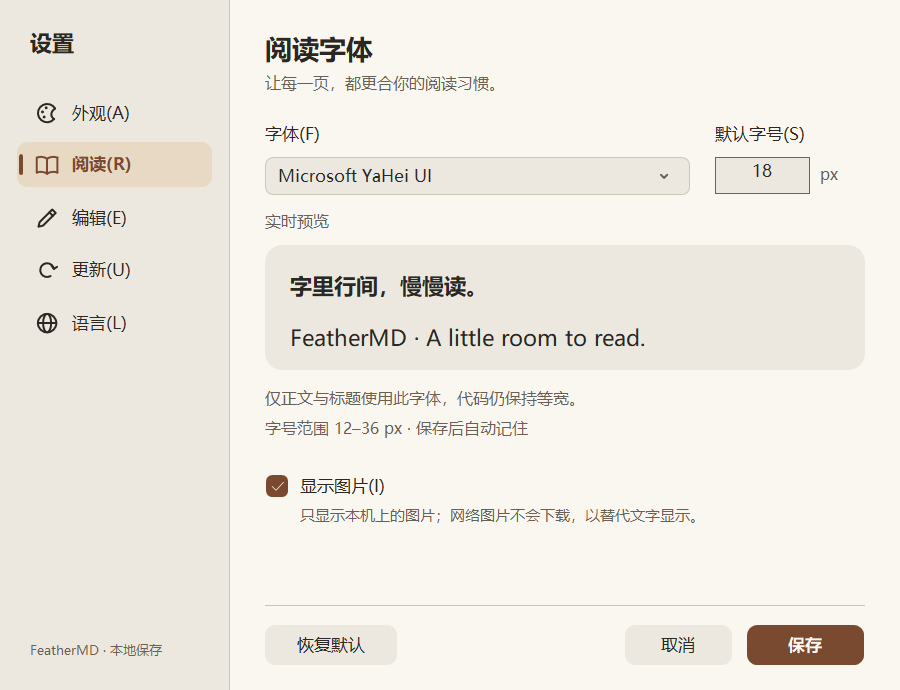
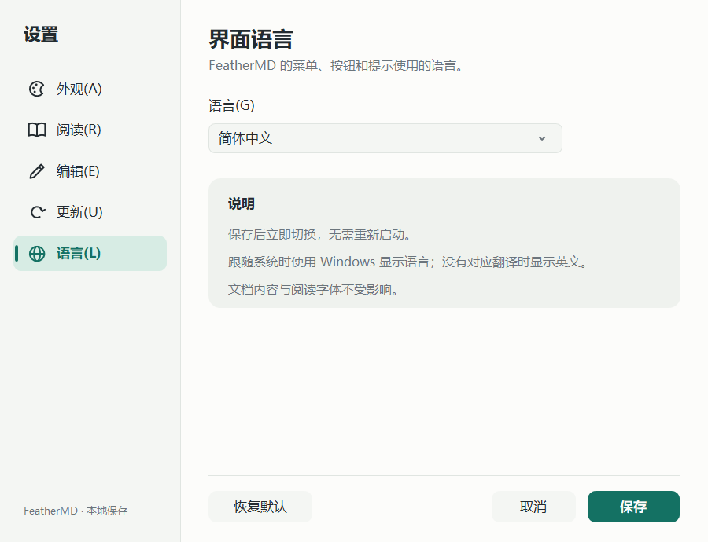
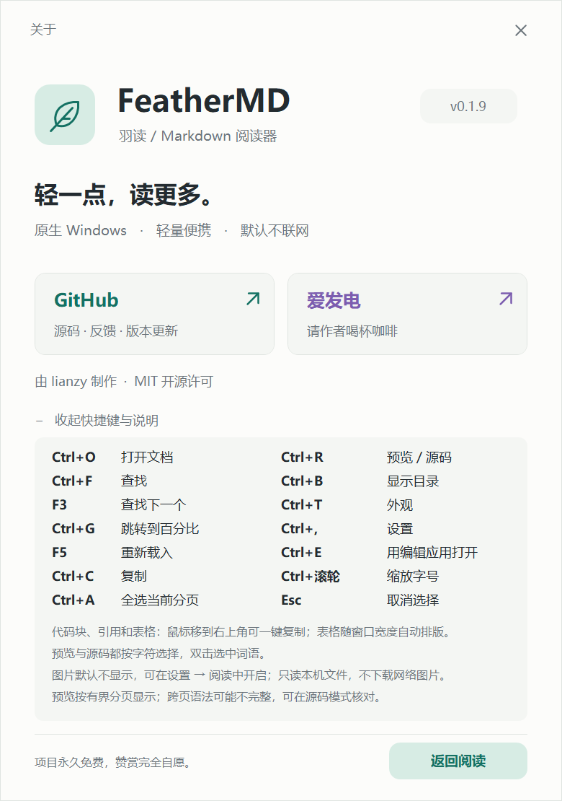

# FeatherMD · 羽读

**简体中文** · [繁體中文](README.zh-TW.md) · [English](README.en.md) · [日本語](README.ja.md)

[](LICENSE)
[](https://ifdian.net/a/lianzy)

**轻一点，读更多。** 一个用 Rust 编写的 Windows 原生 Markdown 查看器。界面支持简体中文、繁體中文、English 和日本語。

[下载单文件 EXE](https://github.com/Lianzy-Baimiao/FeatherMD/releases/latest) · [性能与验证](docs/PERFORMANCE.md) · [实现说明](docs/ARCHITECTURE.md)



顶部是 34 px 高的安静标题栏：左边只有羽毛标识和文档名；右边**打开 / 查找 / 外观 / 更多**四个图标同一尺寸、同一线宽，悬停时出现浅色圆角底并显示名称和快捷键。窗口按钮整列悬停，关闭按钮悬停为红色。预览与源码的**眼睛 / 代码**开关在底部状态栏左侧。图标为 GDI+ 抗锯齿矢量，直线对齐像素网格、曲线圆润平滑。

**外观只占一个按钮**（半黑半白的圆）：点击展开浅色 / 深色 / 跟随系统，第四行“更多皮肤…”进入设置里的 20 款皮肤。也可按 **Ctrl+T**，用方向键或 Tab 选择、Enter 确认、Esc 取消。

**正文右键 → 编辑**（Ctrl+E）：用你选择的编辑应用打开当前文档；FeatherMD 本身保持只读，保存后按 F5 重新载入并停在原位置。

**一键复制**：鼠标移到代码块、引用或表格上，右上角出现“复制”按钮；代码复制原文（不含围栏），表格复制为制表符分隔的单元格。

目录开关仍位于目录区域：展开时在“目录”标题右侧，隐藏后在内容区左边缘。未打开文档时不再显示空目录栏。

新配置默认跟随系统；系统应用颜色改变时会刷新，手动选择的浅色或深色不会被覆盖。主题切换保持阅读位置，阅读模式与主题偏好在重启后保留。

<details>
<summary>更多预览：深色阅读、隐藏目录与欢迎页</summary>


</details>

## 为什么做这个

打开一份 Markdown，不应该先启动一个浏览器。

FeatherMD 使用 Win32 + GDI/GDI+，没有 Electron、WebView、JavaScript 或遥测，默认不联网；只有开启自动检查或手动“检查更新”时才访问 GitHub Releases。v0.1.9 的 Windows x64 EXE 约 **1.04 MiB**（含四种界面语言、代码高亮与本地图片解码），无需安装 .NET、VC++ 运行库或其他第三方运行时。

**大文件不是先全部载入再显示：** 每次只读取附近 128 KiB，后台读取与搜索，前台只绘制可见行。文件总长度不决定首屏需要分配的内存。

## 使用

1. 从 Releases 下载 **FeatherMD.exe**，放到喜欢的文件夹，双击运行。
2. 拖入 Markdown，或按 **Ctrl+O**。
3. 左侧目录点击标题即可跳转；点“目录”标题右侧按钮收起，点内容区左边缘按钮展开，也可按 **Ctrl+B** 切换，状态会保存。
4. 底部状态栏左侧的眼睛/代码开关切换预览/源码（Ctrl+R），顶部外观按钮选择皮肤；省略号“更多 → 设置…”（Ctrl+,）调整皮肤、透明度、字体字号、是否显示图片与默认编辑应用，自动换行与阅读宽度也在“更多”中。
5. **更多 → 关于 FeatherMD**（F1）查看版本、快捷键和阅读说明，或前往 GitHub 项目主页、爱发电支持作者。外部链接会先确认，再交给默认浏览器打开。
6. **更多 → 检查更新…** 手动检查新版本；也可在设置的“更新”页开启打开时自动检查（默认关闭）。
7. **更多 → 界面语言 / Language…** 切换界面语言，保存后立即生效。

支持 Windows 10（1607+）/ Windows 11 **x64**。当前实测环境为 Windows 11 x64；其他版本尚未逐个实机验证。无安装器，无管理员权限要求。尚未购买代码签名证书，Windows SmartScreen 可能提醒未知发布者；请核对来源和 SHA-256，不要关闭系统防护。

### 阅读排版、代码高亮与 HTML 标签

默认字号 16 px，正文行高约 1.6 倍；空行是比一行略短的段落间距，标题上方留白多于下方，一、二级标题下有细线（换行的标题只在最后一行画线）。列表换行后与项目文字对齐，任务清单显示为复选框；引用是灰色竖线与次要色文字；表格隔行浅色斑马纹。

代码块是带圆角底板的等宽文字，字号略小于正文，左上角标出语言。**代码高亮**支持 Rust、C/C++、C#、Java/Kotlin/Scala、Swift、Go、JavaScript/TypeScript、Python、Ruby、PHP、Lua、SQL、Shell、PowerShell、批处理、JSON、YAML、TOML/INI、Dockerfile、CSS、HTML/XML 与 diff：关键字、类型、函数名、字符串、数字、注释等颜色随皮肤调和，跨行的块注释和多行字符串保持着色。行内代码和 `<kbd>` 按键是圆角小底板。

常见 **HTML 标签**按排版显示：`<p>`、`<h1>`–`<h6>`、`<br>`、`<hr>`、`<b>`/`<strong>`、`<i>`/`<em>`、`<u>`、`<s>`/`<del>`、`<code>`、`<kbd>`、`<mark>`、`<sub>`/`<sup>`、`<a>`、``、`<blockquote>`、`<ul>`/`<ol>`/`<li>`、`<pre>`、`<div>`/`<span>`/`<center>`、`<details>`/`<summary>`（总是展开），以及 `align` 属性与 `text-align` 样式的居中/右对齐、常用字符实体。许多 README 开头的 `<h1 align="center">` 也会进入目录。`<script>`、`<style>`、`<iframe>` 等内容既不显示也不执行；标签只改变排版，从不运行任何东西。


### 皮肤与透明度

**更多 → 设置… → 外观**：20 款皮肤，浅色在前、深色在后——跟随系统、浅色、**素白**（纯白纸面）、雾灰、天青、护眼、**书本**（暖白纸页放在亚麻底色上）、**古籍**（米黄宣纸、墨色正文、朱砂强调与双线栏框）、**报纸**（暖灰新闻纸与深蓝链接）、豆沙绿、樱粉、**丁香**；深色、**暮色**（比深色更柔和的夜读灰）、**极夜**（冷调石板蓝）、夜蓝、**深海**（深青底色）、**紫夜**、**咖啡**（暖棕与琥珀色）和纯黑（OLED）。点选即在阅读窗口实时预览，方向键可在卡片间移动；“取消”或 Esc 还原，保存后重启仍保留。代码高亮颜色随每款皮肤调和。

**窗口不透明度** 30%–100%，5% 一档，拖动或用方向键调整；只作用于阅读窗口，设置窗口保持不透明。100% 时不启用分层窗口。所有皮肤的正文与背景对比度不低于 9.8:1，次要文字不低于 4.3:1，链接不低于 4.5:1（有单元测试）。


<details>
<summary>皮肤设置与书本 / 古籍阅读效果</summary>


</details>

### 右键编辑与默认编辑应用

FeatherMD 只读。需要修改时，在正文 **右键 → 编辑**，或按 **Ctrl+E**，当前文档会作为单个带引号的参数交给编辑应用；保存后回到阅读器按 **F5**，重新载入并保持阅读位置。右键菜单还包含复制、全选当前分页、查找与重新载入，**Shift+F10** / 菜单键同样可用。

**更多 → 设置… → 编辑** 选择默认编辑应用：

- **系统默认**：使用 Windows 为该文件类型登记的“编辑”方式；没有登记时改用系统记事本。
- **记事本**，以及自动检测到的 VS Code、VSCodium、Cursor、Typora、MarkText、Notepad++、Sublime Text、Zed、EmEditor（只检查固定安装位置与 App Paths 登记，不扫描磁盘）。
- **浏览…** 选择本机磁盘上任意 .exe。只接受盘符开头的绝对路径，不能选 FeatherMD 本身。

编辑应用找不到时会提示并可直接重新选择。这个设置不会修改 Windows 的默认打开方式或文件关联。


### 一键复制代码块、引用与表格

在预览中把鼠标移到代码块、引用或表格上，右上角会出现**复制**按钮，点一下即可复制整块内容：

- **代码块**：复制文件里的原文，不含 ```` ``` ```` 围栏行；缩进代码去掉一级缩进；制表符保留，行间为 CRLF。
- **引用**：复制显示出来的文字，同一行自动换行的部分不会多出换行。
- **表格**：每行复制为制表符分隔的单元格，可直接粘贴到表格软件。

很长的代码块向下滚动时，按钮停在可见部分的顶端，不必滚回开头。表格比正文窄时，按钮放在表格右侧，不遮挡表头。复制后按钮显示约 1.5 秒的对勾，状态栏说明复制了什么；块超出当前缓存分页（约 128 KiB）时只复制已载入的部分，状态栏同样会说明。源码模式没有复制按钮，请按字符选择后复制。


### 显示本地图片

**更多 → 设置… → 阅读 → 显示图片**，**默认不勾选**。不勾选时，图片显示为“[图片: 替代文字]”，FeatherMD 不读取任何图片文件。

勾选后只显示**本机上的图片**：相对路径从文档所在文件夹开始（`/assets/a.png` 也一样），盘符开头的绝对路径与 `file:///C:/…` 也可以。格式按文件内容识别（PNG、JPEG、GIF、BMP、TIFF、ICO），不看扩展名；JPEG 按 EXIF 方向摆正，透明部分透出皮肤底色，GIF 显示第一帧。图片按 CSS 像素随 DPI 缩放，`` 可指定大小，太宽时缩到正文宽度、太高时不超过阅读区；只有图片的行（Logo、截图、徽章）和段落里的小图标都会显示，带链接的图片可以点击。

以下情况**不读取**，在原位置显示替代文字和原因：网络图片（http/https、`//主机/…`，从不下载）、符号链接或联接点后面的文件、网络驱动器与共享文件夹、设备路径、仅在云端尚未下载的 OneDrive 文件、找不到的文件、SVG/WebP 等不支持的格式，以及超过 32 MiB、3200 万像素或单边 16384 px 的图片。

读取和解码在后台线程进行，不阻塞阅读；每页最多 64 张，已解码的图片共用约 160 MiB 的上限，较早页面的图片先释放。取消勾选立即释放所有图片。


<details>
<summary>设置 → 阅读：显示图片</summary>



</details>

### 界面语言

界面支持**简体中文、繁體中文、English、日本語**。默认跟随 Windows 显示语言：台湾、香港和澳门使用繁體中文，其他中文地区使用简体中文，日语使用日本語，没有对应翻译的语言显示英文。

在 **更多 → 界面语言 / Language…**（即设置的“语言”页）选择语言，保存后菜单、按钮、提示和对话框立即切换，无需重新启动。每种语言使用对应地区字形的界面字体（微软雅黑 UI、微軟正黑體 UI、Yu Gothic UI）；文档内容和阅读字体不受影响。本说明也有 [繁體中文](README.zh-TW.md)、[English](README.en.md) 和 [日本語](README.ja.md) 版本。



### 表格

GitHub 风格的管道表格（表头行 + `| --- | :-: | --: |` 分隔行）显示为带表头底色和边框的表格，单元格内支持粗体、行内代码和链接，分隔行里的冒号决定左对齐、居中或右对齐。

列宽随窗口自动调整：放得下时每列保持内容宽度；放不下时先收窄最宽的列，短列保持原样，单元格内按词或中文字符换行，逗号、句号等标点不会出现在行首。窗口变窄、隐藏目录或缩放字号时立即重新排版。

列太多、连最窄的可读列宽（约 6 个字）都放不下时，只有这张表格横向滚动（底部滚动条、Shift+滚轮或左右方向键），正文和放得下的表格保持不动。关闭自动换行时，表格保持内容宽度，与正文一起横向滚动。


### 按字符选择

预览和源码（Ctrl+R）都可以用鼠标按字符拖选：双击选中一个词，Shift+单击扩展选区，拖到正文上下边缘外会自动滚动并继续选择。Ctrl+A 选中当前分页，Esc 取消选区，Ctrl+C 或右键“复制选中文本”复制；没有选区时复制当前可见的内容。

- **预览**复制显示出来的文字：同一段落自动换行的几行连成一行（换行处去掉的空格会补回），段落之间为 CRLF；表格按整行选择，复制为制表符分隔的单元格；图片复制它的替代文字。缩放字号、改变窗口大小或图片载入后，选区仍是原来的那些字。
- **源码**复制文件里的**原文**：制表符保持为制表符，中文与 emoji 不会被截断，行与行之间为 CRLF，超长单行拆开显示的片段之间不会多出换行。

选区跨出当前缓存分页（约 128 KiB）时只复制已载入的部分，状态栏会说明。复制单个代码块、引用或表格时，用它右上角的复制按钮更方便。


### 检查更新

更新源是本项目的 [GitHub Releases](https://github.com/Lianzy-Baimiao/FeatherMD/releases)。

- **手动检查**：更多 → 检查更新…，打开设置的“更新”页并立即检查。结果显示“已是最新版本”、“发现新版本”（含版本名与发布日期）或失败原因（网络、代理、GitHub 访问频率限制等）。
- **打开时自动检查**：在“更新”页勾选并保存，**默认关闭**。开启后在启动约 3 秒后于后台检查，每 24 小时最多一次；失败时不打扰，下次启动再试。
- **发现新版本**时，顶部“更多”按钮出现一个小圆点，菜单项显示“发现新版本 vX.Y.Z…”，升级后自动消失。“前往下载页…”会先确认，再用默认浏览器打开对应的 Release 页面。

检查只通过 Windows 自带的 WinHTTP 以 HTTPS 请求 `api.github.com` 上的公开版本信息，沿用系统代理设置和证书校验；不上传文档、设置或其他数据，也**不会自动下载或安装**任何文件。关闭自动检查且不点“立即检查”时，FeatherMD 不会联网。


### 字体与默认字号

**更多（…）→ 字体与默认字号…**（即设置的“阅读”页）：从系统已安装字体中选择，支持中英文字体；设置 **12–36 px** 的默认字号，实时查看示例。点击“保存”应用并记住，“取消”或 Esc 不改动当前设置，“恢复默认”只重置当前页草稿，保存后才生效。

正文字体也用于标题，界面文字保持原样；源码、代码块和行内代码继续使用等宽字体。字体不含某个字符时由 Windows 回退显示。默认字号 16 px；默认正文字体跟随界面语言（简体中文与 English 为微软雅黑 UI、繁體中文为微軟正黑體 UI、日本語为 Meiryo），切换界面语言时随之改变，选定其他字体后就固定使用它。字号与 Ctrl+滚轮/加减号缩放共用一个持久化值，后续打开与重启时沿用最近保存的大小。

顶部与欢迎页图标使用 Windows GDI+ 抗锯齿矢量曲线、圆端描边，按 DPI 绘制；没有额外图标字体、图片下载或第三方运行时。

<details>
<summary>字体设置：浅色与深色</summary>


</details>

### 关于与项目入口

**更多 → 关于 FeatherMD**（F1）：与阅读器配色一致的原生窗口，包含版本、GitHub 项目主页和爱发电入口。展开“快捷键与阅读说明”可查看两列快捷键（包括 Ctrl+E 编辑、Ctrl+, 设置、Ctrl+T 外观、Esc 取消选择），以及一键复制、表格排版、按字符选择、显示图片和分页预览的说明；支持 Tab、Enter、Esc。窗口沿用当前皮肤和界面语言。

<details>
<summary>查看关于窗口：浅色与深色</summary>




</details>

### 右键打开方式与默认应用


- 先将 EXE 放在**固定位置**。
- 点击 **更多 → 文件关联 → 加入 Markdown 右键打开方式**，即可注册到当前用户的打开方式列表，不弹出确认框或系统设置。
- 需要双击 .md 默认用 FeatherMD 时，点击 **更多 → 文件关联 → 设为 .md 默认应用（系统确认）**。会自动完成注册并打开 Windows 默认应用设置；选择 **.md → FeatherMD**。较旧 Windows 可能显示默认应用首页，需要搜索 .md。
- 如果列表找不到 FeatherMD：确认正在运行的是**固定位置里的新版 EXE**，再次执行上述注册或设为默认操作，关闭再打开 Windows 默认应用页。在应用列表搜索 FeatherMD，或在文件类型搜索 `.md`；仍不显示时，可在“选择其他应用”中浏览到该 EXE。注册到列表不等于已成为默认应用。
- 也可以右键 .md 文件 → 打开方式 → 选择其他应用 → FeatherMD → 始终使用。
- 支持注册 .md / .markdown / .mdown / .mkd。
- “移除打开方式注册”只移除 FeatherMD 自己的注册项。

Windows 10/11 要求用户在系统界面确认默认应用，普通桌面程序没有受支持的静默设置方式。因此“加入打开方式”可以静默完成，“设为默认”仍需系统确认。移动 EXE 后需要重新注册；移除注册不会自动选择另一个默认查看器。

具体兼容范围及微软文档见 [文件关联说明](docs/FILE_ASSOCIATIONS.md)。

### v0.1.2 界面与导航

- 自绘标题栏、边框、窗口按钮和浅色/深色/护眼界面；移除独立工具栏，增加正文空间。
- 可隐藏的分级标题目录，独立滚轮滚动、点击定位，后台提取不阻塞首屏。
- 自绘纵向/横向滚动条支持拖动和轨道翻页，修复原生拖动消息重入导致正文不移动的问题。
- 快速拖离缓存再返回时，过期分页结果不会把阅读位置拉走；短文件隐藏无用滚动条。

目录支持 `#` 至 `######` 标题，并排除代码围栏内容。为保持大文件响应速度，每份目录最多扫描前 **16 MiB**、显示 **4096 个标题**；达到上限时目录底部提示。Setext（下划线式）标题不收录；正文阅读与全文搜索不受目录范围限制。重新加载（F5）会重新提取目录。

### 已有阅读改进

- End 会显示完整末屏，最后一段很长且自动换行时也能到达真正结尾。
- PageUp / PageDown 按实际行高翻页并保留重叠行，避免大标题导致漏读。
- 反向跨缓存分页不再按固定字节后退；中文长段落分页保留当前换行位置。
- 未选择时复制的范围按真实可见行计算。

### 快捷键

| 操作 | 快捷键 |
| --- | --- |
| 打开文件 | Ctrl+O / 拖放 |
| 显示 / 隐藏目录 | Ctrl+B / 目录区域的折叠按钮 |
| 后台查找（区分大小写的原文搜索） | Ctrl+F |
| 下一个匹配（到末尾会回绕） | Enter / F3 |
| 取消搜索 / 关闭搜索栏 | Esc |
| 按字节百分比跳转 | Ctrl+G |
| 文件开头 / 结尾 | Home / End |
| 滚动 | 滚轮 / ↑↓ / PageUp / PageDown / 空格 |
| 放大 / 缩小 | Ctrl+滚轮 / Ctrl++ / Ctrl+- |
| 源码 / 预览切换 | Ctrl+R |
| 外观选择（浅色 / 深色 / 跟随系统 / 更多皮肤） | Ctrl+T / 顶部外观按钮 |
| 设置（皮肤、透明度、字体、编辑应用） | Ctrl+, |
| 用默认编辑应用打开当前文档 | Ctrl+E / 正文右键 → 编辑 |
| 正文右键菜单 | 右键 / Shift+F10 / 菜单键 |
| 重新载入（保持阅读位置） | F5 |
| 选择当前缓存分页 | Ctrl+A |
| 复制选中内容（预览复制显示的文字，源码复制原文）；未选择时复制可见内容 | Ctrl+C |
| 复制整个代码块、引用或表格 | 鼠标移到块上 → 右上角“复制” |
| 界面语言 | 更多 → 界面语言 / Language… |
| 取消选区 | Esc |
| 恢复默认阅读设置 | Ctrl+0 |
| 检查更新 | 更多 → 检查更新… |
| 帮助 | F1 |

鼠标拖选：预览与源码都**按字符**（双击选词、Shift+单击扩展），预览中的表格按整行。关闭换行或表格过宽时可使用底部滚动条或左右方向键。

### 设置文件

默认写入 %APPDATA%\FeatherMD\settings.ini，每次修改自动保存。文档本身始终只读。皮肤、透明度与编辑应用分别保存为 `theme`、`opacity`、`editor`；显示图片为 `images`（`true` / `false`，默认 `false`）；`font_family` 为空表示正文字体跟随界面语言；自动检查开关为 `update_check`，上次成功检查的时间与所见最新版本为 `update_checked`、`update_latest`。界面语言为 `language`（`system`、`zh-CN`、`zh-TW`、`en`、`ja`，默认 `system`）。无效值回到默认，带 BOM 的 UTF-8 文件也能读取。

需要可携带设置时，在 EXE 旁创建一个空的 **FeatherMD.ini**，以后设置随这个文件保存。只想单文件运行则不需要它。最近文件和文档正文不会写入设置。

## 阅读支持与明确边界

- 文档支持 UTF-8 / UTF-8 BOM 与系统字体可显示的 Unicode（不限语言）；界面文字支持简体中文、繁體中文、English、日本語。
- 标题、粗体、斜体、删除线、行内代码、代码围栏（常见语言高亮）、引用、列表、任务清单、分隔线、网页链接、GitHub 风格表格（按窗口宽度自动排版）与常见 HTML 标签。
- 图片默认显示替代文字；开启“显示图片”后只显示本机图片（规则见上文），从不下载网络图片。
- HTML 只用于排版，不执行脚本、不加载外部资源；不支持的标签与 CSS 被忽略。仅 http/https 链接可经确认后打开。
- **这是低内存分段预览，不是完整 CommonMark/GFM 浏览器渲染器。** 除表格外按物理行排版；跨行强调、Setext 标题、复杂嵌套（例如列表里的表格）、全局引用链接等可能不按完整规范呈现。
- 非起始分页不扫描整份文件来恢复状态，跨页代码围栏/列表上下文可能不完整，状态栏会提示。分页从表格中间开始、看不到表头时，这部分显示为没有表头的表格。需要精确原文时切换源码模式。
- 超长单行拆为最多 4096 字节的安全 Unicode 片段，防止一个段落阻塞 UI。
- UTF-16/UTF-32 BOM 文档明确提示先转换成 UTF-8；其他无效 UTF-8 字节显示替代字符并提示。不会自行改写文件。
- 全文搜索仍需顺序读取数据，速度取决于设备；搜索可取消。网络盘、机械硬盘、文件锁或系统负载也会影响速度。
- 自绘正文尚不具备完整屏幕阅读器语义。HTML 按行处理：跨多行的单个标签、表格标签（`<table>` 显示为用“·”分隔的文字行）和嵌套很深的结构可能不按浏览器呈现；表格单元格里的图片显示替代文字。

**不承诺“任意大小瞬间完整渲染”。** 目标是有界读取、快速首屏和可响应的交互。

## 实测摘要

首版 v0.1.0 基准：本机 Windows 11 x64，Release 构建、暖缓存、1 GiB 实体 UTF-8 Markdown：

- 后台读取 + Markdown 解析首分页，中位数 **1.05 ms**（30 次；不含 GDI 排版）。
- 隐藏真实窗口测试，启动到首分页排版约 **75 ms**（单次，非冷启动保证）。
- 测试结束私有内存约 **7.1 MiB**，工作集约 **26.4 MiB**（含系统 GUI DLL）。
- 100 GiB **稀疏文件**通过首尾/随机读取验证；这不等于扫描了 100 GiB 实际 Markdown 内容。

完整方法、数字和限制见 [PERFORMANCE.md](docs/PERFORMANCE.md)。

v0.1.1 已复测相同 1 GiB 文件，首分页排版 59.60 ms（单次暖缓存），详见性能记录；不把不同轮次的波动解释为普遍性能提升。

## 从源码构建

安装 Rust stable 和 Visual Studio Build Tools 的“使用 C++ 的桌面开发”组件 / Windows SDK，然后在 x64 Developer PowerShell 中：

~~~powershell
cargo +stable-x86_64-pc-windows-msvc test
cargo +stable-x86_64-pc-windows-msvc clippy --all-targets -- -D warnings
cargo +stable-x86_64-pc-windows-msvc build --release
~~~

产物：target/release/feathermd.exe。MSVC 静态 CRT 配置位于 .cargo/config.toml。项目源路径含中文也可构建；不推荐缺少 windres 的 GNU 工具链。

~~~powershell
# 无干扰隐藏窗口测试：主题、真实输入搜索、百分比跳转、GDI 资源、退出
./scripts/ui-smoke.ps1
./scripts/navigation-smoke.ps1
./scripts/navigation-smoke.ps1 -Shape wrapped -Output ./test-artifacts/navigation-wrapped
./scripts/scrollbar-smoke.ps1
./scripts/window-smoke.ps1
./scripts/settings-smoke.ps1
# 表格排版、横向滚动、一键复制与预览/源码按字符选择（复制内容经测试接口读取，不改动剪贴板）
./scripts/table-smoke.ps1
# 本地图片：默认关闭；开启后尺寸、EXIF 方向、透明、徽章、链接、拒绝联接点与原因说明（图片在测试中生成）
./scripts/image-smoke.ps1
# 四种界面语言的所有视图：文字不得被截断，保存后立即切换
./scripts/i18n-smoke.ps1
# 编辑与更新测试使用替身编辑器和本机回环的替身 GitHub 接口，不访问网络
cargo +stable-x86_64-pc-windows-msvc build --release --example editor_probe --example update_server
./scripts/editor-smoke.ps1
./scripts/update-smoke.ps1

# 生成 1 MiB / 64 MiB / 1 GiB 实体测试文件（约占 1.1 GiB）
./scripts/make-fixtures.ps1
cargo +stable-x86_64-pc-windows-msvc run --release --example bench -- test-artifacts/fixtures/1073741824.md 30
~~~

核心读取、解析与设置逻辑可在 Linux 上测试，GUI 仅支持 Windows。测试会创建并删除一个 100 GiB 稀疏文件，实际占用很小，需要支持稀疏文件的文件系统。

## License

[MIT](LICENSE)。依赖许可证见 [THIRD_PARTY_NOTICES.md](THIRD_PARTY_NOTICES.md)，也内置在 EXE 中，可通过“更多 → 导出内置许可证”保存。

## 项目与赞赏

FeatherMD 免费、开源，无广告。欢迎在 [GitHub 项目主页](https://github.com/Lianzy-Baimiao/FeatherMD) 反馈问题或参与改进。

如果它让你的阅读轻快了一点，欢迎通过 [爱发电](https://ifdian.net/a/lianzy) 请作者喝一杯。赞赏完全自愿，不影响任何功能；应用内“更多 → 关于 FeatherMD”也有入口。
