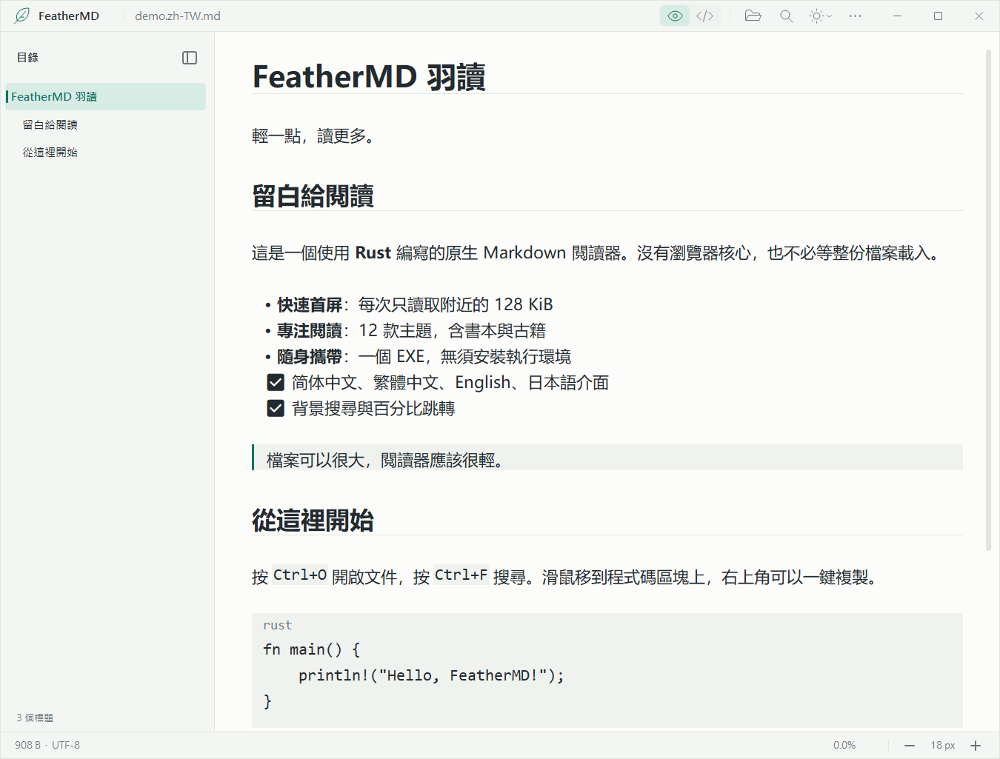
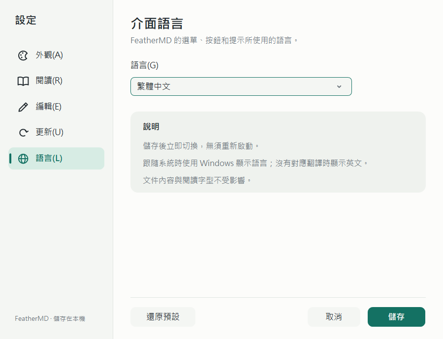
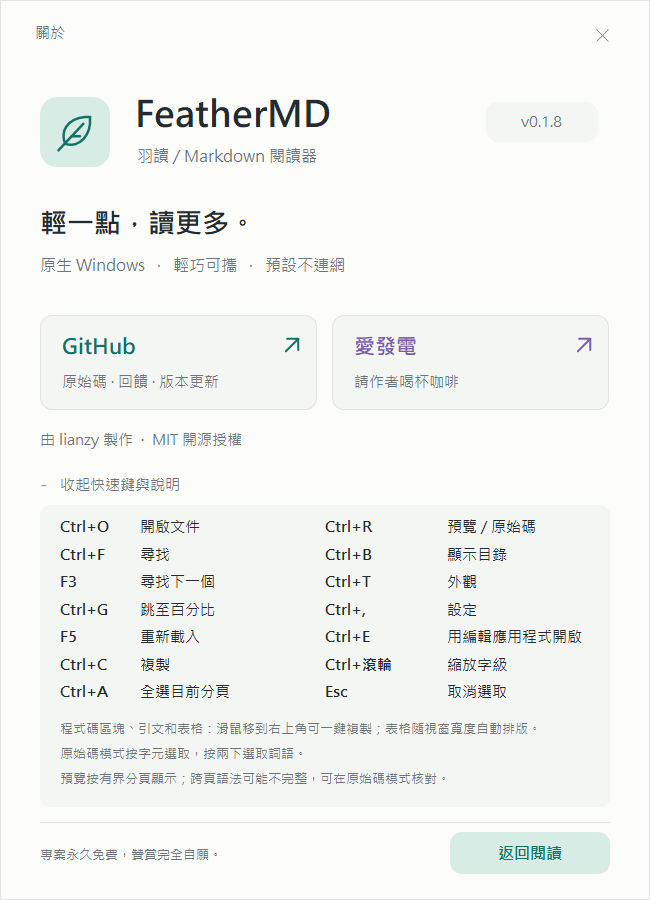

# FeatherMD · 羽讀

[简体中文](README.md) · **繁體中文** · [English](README.en.md) · [日本語](README.ja.md)

[](LICENSE)
[](https://ifdian.net/a/lianzy)

**輕一點，讀更多。** 一個用 Rust 編寫的 Windows 原生 Markdown 檢視器。介面支援简体中文、繁體中文、English 和日本語。

[下載單一檔案 EXE](https://github.com/Lianzy-Baimiao/FeatherMD/releases/latest) · [效能與驗證](docs/PERFORMANCE.md)（簡體中文） · [實作說明](docs/ARCHITECTURE.md)（英文）



頂部是 34 px 高的精簡單行圖示列：**眼睛 / 程式碼**膠囊切換預覽與原始碼，**資料夾 / 放大鏡 / 省略號**分別開啟文件、尋找與更多。圖示為 GDI+ 反鋸齒向量，直線對齊像素格線、曲線圓潤平滑；滑鼠停留時顯示名稱和快速鍵。

**外觀只佔一個按鈕**：太陽、月亮、顯示器或調色盤代表目前的主題，按一下展開淺色 / 深色 / 跟隨系統，第四列「更多主題…」進入設定。也可以按 **Ctrl+T**，用方向鍵或 Tab 選擇、Enter 確認、Esc 取消。

**內文按右鍵 → 編輯**（Ctrl+E）：用你選擇的編輯應用程式開啟目前文件；FeatherMD 本身維持唯讀，儲存後按 F5 重新載入並停在原位置。

**一鍵複製**：滑鼠移到程式碼區塊、引文或表格上，右上角會出現「複製」按鈕；程式碼複製原文（不含圍欄），表格複製為以定位字元分隔的儲存格。

目錄開關仍位於目錄區域：展開時在「目錄」標題右側，隱藏後在內容區左邊緣。尚未開啟文件時不顯示空的目錄欄。

新設定預設跟隨系統；系統應用程式色彩改變時會重新整理，手動選擇的淺色或深色不會被覆蓋。切換主題會保留閱讀位置，閱讀模式與主題偏好在重新啟動後保留。

本文後面的截圖以简体中文介面為主；所有畫面都能以繁體中文顯示（見[介面語言](#介面語言)）。

<details>
<summary>更多預覽：深色閱讀、隱藏目錄與歡迎頁</summary>


</details>

## 為什麼做這個

開啟一份 Markdown，不應該先啟動一個瀏覽器。

FeatherMD 使用 Win32 + GDI/GDI+，沒有 Electron、WebView、JavaScript 或遙測，預設不連網；只有開啟自動檢查或手動「檢查更新」時才存取 GitHub Releases。v0.1.8 的 Windows x64 EXE 約 **914 KiB**（含四種介面語言），無須安裝 .NET、VC++ 執行階段或其他第三方執行環境。

**大檔案不是先全部載入再顯示：** 每次只讀取附近 128 KiB，在背景讀取與搜尋，前景只繪製可見的行。檔案總長度不決定第一頁需要配置的記憶體。

## 使用

1. 從 Releases 下載 **FeatherMD.exe**，放到喜歡的資料夾，按兩下執行。
2. 拖入 Markdown，或按 **Ctrl+O**。
3. 在左側目錄按一下標題即可跳轉；按「目錄」標題右側的按鈕收起，按內容區左邊緣的按鈕展開，也可以按 **Ctrl+B** 切換，狀態會保存。
4. 頂部眼睛 / 程式碼圖示切換預覽 / 原始碼，外觀按鈕選擇主題；省略號「更多 → 設定…」（Ctrl+,）調整主題、透明度、字型字級、預設編輯應用程式與介面語言，自動換行與閱讀寬度也在「更多」中。
5. **更多 → 關於 FeatherMD**（F1）查看版本、快速鍵和閱讀說明，或前往 GitHub 專案首頁、愛發電支持作者。外部連結會先確認，再交給預設瀏覽器開啟。
6. **更多 → 檢查更新…** 手動檢查新版本；也可以在設定的「更新」頁開啟啟動時自動檢查（預設關閉）。
7. **更多 → 介面語言 / Language…** 切換介面語言，儲存後立即生效。

支援 Windows 10（1607+）/ Windows 11 **x64**。目前實測環境為 Windows 11 x64；其他版本尚未逐一實機驗證。沒有安裝程式，不需要系統管理員權限。尚未購買程式碼簽章憑證，Windows SmartScreen 可能提醒未知的發行者；請核對來源和 SHA-256，不要關閉系統防護。

### 主題與透明度

**更多 → 設定… → 外觀**：12 款主題——跟隨系統、淺色、深色、護眼，**書本**（暖白紙頁放在亞麻底色上）、**古籍**（米黃宣紙、墨色內文、朱砂強調與雙線欄框），以及豆沙綠、天青、櫻粉、霧灰、夜藍和純黑（OLED）。點選即在閱讀視窗即時預覽，方向鍵可在卡片間移動；「取消」或 Esc 還原，儲存後重新啟動仍保留。

**視窗不透明度** 30%–100%，每檔 5%，拖曳或用方向鍵調整；只作用於閱讀視窗，設定視窗維持不透明。100% 時不啟用分層視窗。所有主題的內文與背景對比度不低於 9.8:1，次要文字不低於 4.3:1。

<details>
<summary>主題設定與書本 / 古籍閱讀效果</summary>


</details>

### 右鍵編輯與預設編輯應用程式

FeatherMD 唯讀。需要修改時，在內文**按右鍵 → 編輯**，或按 **Ctrl+E**，目前文件會以單一加引號的參數交給編輯應用程式；儲存後回到閱讀器按 **F5**，重新載入並保持閱讀位置。右鍵選單還包含複製、全選目前分頁、尋找與重新載入，**Shift+F10** / 選單鍵同樣可用。

**更多 → 設定… → 編輯** 選擇預設編輯應用程式：

- **系統預設**：使用 Windows 為該檔案類型登錄的「編輯」方式；沒有登錄時改用系統記事本。
- **記事本**，以及自動偵測到的 VS Code、VSCodium、Cursor、Typora、MarkText、Notepad++、Sublime Text、Zed、EmEditor（只檢查固定安裝位置與 App Paths 登錄，不掃描磁碟）。
- **瀏覽…** 選擇本機磁碟上任意 .exe。只接受以磁碟機代號開頭的絕對路徑，不能選 FeatherMD 本身。

找不到編輯應用程式時會提示，並可直接重新選擇。這個設定不會修改 Windows 的預設開啟方式或檔案關聯。


### 一鍵複製程式碼區塊、引文與表格

在預覽中把滑鼠移到程式碼區塊、引文或表格上，右上角會出現**複製**按鈕，按一下即可複製整個區塊：

- **程式碼區塊**：複製檔案裡的原文，不含 ```` ``` ```` 圍欄行；縮排程式碼去掉一層縮排；定位字元保留，行與行之間為 CRLF。
- **引文**：複製畫面上顯示的文字，同一行自動換行的部分不會多出換行。
- **表格**：每列複製為以定位字元分隔的儲存格，可直接貼到試算表軟體。

很長的程式碼區塊向下捲動時，按鈕停在可見部分的頂端，不必捲回開頭。表格比內文窄時，按鈕放在表格右側，不遮住表頭。複製後按鈕顯示約 1.5 秒的勾號，狀態列說明複製了什麼；區塊超出目前快取分頁（約 128 KiB）時只複製已載入的部分，狀態列同樣會說明。原始碼模式沒有複製按鈕，請按字元選取後複製。


### 介面語言

介面支援 **简体中文、繁體中文、English、日本語**。預設跟隨 Windows 顯示語言：台灣、香港和澳門使用繁體中文，其他中文地區使用简体中文，日文使用日本語，沒有對應翻譯的語言顯示英文。

在 **更多 → 介面語言 / Language…**（即設定的「語言」頁）選擇語言，儲存後選單、按鈕、提示和對話方塊立即切換，無須重新啟動。每種語言使用對應地區字形的介面字型（微軟雅黑體 UI、微軟正黑體 UI、Yu Gothic UI）；文件內容和閱讀字型不受影響。本說明也有 [简体中文](README.md)、[English](README.en.md) 和 [日本語](README.ja.md) 版本。



### 表格

GitHub 風格的管線表格（表頭列 + `| --- | :-: | --: |` 分隔列）顯示為帶表頭底色和框線的表格，儲存格內支援粗體、行內程式碼和連結，分隔列裡的冒號決定靠左、置中或靠右對齊。

欄寬隨視窗自動調整：放得下時每欄保持內容寬度；放不下時先收窄最寬的欄，短欄維持原樣，儲存格內按詞或中文字元換行，逗號、句號等標點不會出現在行首。視窗變窄、隱藏目錄或縮放字級時立即重新排版。

欄太多、連最窄的可讀欄寬（約 6 個字）都放不下時，只有這張表格水平捲動（底部捲軸、Shift+滾輪或左右方向鍵），內文和放得下的表格維持不動。關閉自動換行時，表格保持內容寬度，與內文一起水平捲動。


### 原始碼模式按字元選取

原始碼模式（Ctrl+R）下用滑鼠按字元拖曳選取，游標為文字游標；按兩下選取一個詞，Shift+按一下延伸選取範圍，拖到內文上下邊緣外會自動捲動並繼續選取。Ctrl+A 選取目前分頁，Esc 取消選取，Ctrl+C 或右鍵「複製選取的文字」複製。

複製的是檔案裡的**原文**：定位字元維持為定位字元，中文與 emoji 不會被截斷，行與行之間為 CRLF，超長單行拆開顯示的片段之間不會多出換行。沒有選取時複製目前可見的原文。選取範圍超出目前快取分頁（約 128 KiB）時只複製已載入的部分，狀態列會說明。

預覽模式仍按整行選取；表格列複製為以定位字元分隔的儲存格，可直接貼到試算表軟體。複製單一程式碼區塊、引文或表格時，用它右上角的複製按鈕更方便。


### 檢查更新

更新來源是本專案的 [GitHub Releases](https://github.com/Lianzy-Baimiao/FeatherMD/releases)。

- **手動檢查**：更多 → 檢查更新…，開啟設定的「更新」頁並立即檢查。結果顯示「已是最新版本」、「發現新版本」（含版本名稱與發布日期）或失敗原因（網路、Proxy、GitHub 存取頻率限制等）。
- **啟動時自動檢查**：在「更新」頁勾選並儲存，**預設關閉**。開啟後在啟動約 3 秒後於背景檢查，每 24 小時最多一次；失敗時不打擾，下次啟動再試。
- **發現新版本**時，頂部「更多」按鈕出現一個小圓點，選單項目顯示「發現新版本 vX.Y.Z…」，升級後自動消失。「前往下載頁面…」會先確認，再用預設瀏覽器開啟對應的 Release 頁面。

檢查只透過 Windows 內建的 WinHTTP 以 HTTPS 要求 `api.github.com` 上公開的版本資訊，沿用系統 Proxy 設定和憑證驗證；不上傳文件、設定或其他資料，也**不會自動下載或安裝**任何檔案。關閉自動檢查且不按「立即檢查」時，FeatherMD 不會連網。


### 字型與預設字級

**更多（…）→ 字型與預設字級…**（即設定的「閱讀」頁）：從系統已安裝的字型中選擇，支援中英文字型；設定 **12–36 px** 的預設字級，即時查看範例。按「儲存」套用並記住，「取消」或 Esc 不改動目前設定，「還原預設」只重設目前頁面的草稿，儲存後才生效。

內文字型也用於標題，介面文字維持原樣；原始碼、程式碼區塊和行內程式碼繼續使用等寬字型。字型缺少某個字元時由 Windows 遞補顯示。字級與 Ctrl+滾輪 / Ctrl++ / Ctrl+- 縮放共用一個保存值，之後開啟與重新啟動時沿用最近儲存的大小。

頂部與歡迎頁圖示使用 Windows GDI+ 反鋸齒向量曲線、圓端筆觸，依 DPI 繪製；沒有額外的圖示字型、圖片下載或第三方執行環境。

<details>
<summary>字型設定：淺色與深色</summary>


</details>

### 關於與專案入口

**更多 → 關於 FeatherMD**（F1）：與閱讀器配色一致的原生視窗，包含版本、GitHub 專案首頁和愛發電入口。展開「快速鍵與閱讀說明」可查看兩欄快速鍵（包括 Ctrl+E 編輯、Ctrl+, 設定、Ctrl+T 外觀、Esc 取消選取），以及一鍵複製、表格排版、原始碼按字元選取和分頁預覽的說明；支援 Tab、Enter、Esc。視窗沿用目前主題和介面語言。

<details>
<summary>關於視窗：繁體中文（淺色）與简体中文（深色）</summary>




</details>

### 右鍵開啟方式與預設應用程式


- 先將 EXE 放在**固定位置**。
- 按 **更多 → 檔案關聯 → 加入 Markdown 右鍵開啟方式**，即可登錄到目前使用者的開啟方式清單，不彈出確認方塊或系統設定。
- 需要按兩下 .md 時預設用 FeatherMD 開啟，請按 **更多 → 檔案關聯 → 設為 .md 預設應用程式（系統確認）…**。會自動完成登錄並開啟 Windows 預設應用程式設定；選擇 **.md → FeatherMD**。較舊的 Windows 可能顯示預設應用程式首頁，需要搜尋 .md。
- 如果清單找不到 FeatherMD：確認正在執行的是**固定位置裡的新版 EXE**，再次執行上述登錄或設為預設的操作，關閉再開啟 Windows 預設應用程式頁面。在應用程式清單搜尋 FeatherMD，或在檔案類型搜尋 `.md`；仍不顯示時，可在「選擇其他應用程式」中瀏覽到該 EXE。登錄到清單不等於已成為預設應用程式。
- 也可以在 .md 檔案按右鍵 → 開啟檔案 → 選擇其他應用程式 → FeatherMD → 一律使用。
- 支援登錄 .md / .markdown / .mdown / .mkd。
- 「移除開啟方式登錄…」只移除 FeatherMD 自己的登錄項目。

Windows 10/11 要求使用者在系統介面確認預設應用程式，一般桌面程式沒有受支援的靜默設定方式。因此「加入開啟方式」可以靜默完成，「設為預設」仍需系統確認。移動 EXE 後需要重新登錄；移除登錄不會自動選擇另一個預設檢視器。

具體相容範圍及微軟文件見[檔案關聯說明](docs/FILE_ASSOCIATIONS.md)（簡體中文）。

### 目錄與導覽

- 自繪標題列、邊框和視窗按鈕，沒有獨立工具列，讓內文有更多空間。
- 可隱藏的分級標題目錄可獨立以滾輪捲動，按一下標題即可定位；目錄在背景擷取，不延遲第一頁。
- 自繪垂直 / 水平捲軸支援拖曳和在軌道上翻頁；快速拖離快取再返回時，過期的分頁結果不會把閱讀位置拉走。短檔案隱藏用不到的捲軸。
- End 會顯示完整的最後一屏，最後一段很長且自動換行時也能到達真正的結尾。PageUp / PageDown 依實際行高翻頁並保留重疊的一行，避免大標題導致漏讀。反向跨快取分頁時，中文長段落保留目前的換行位置；未選取時複製的範圍依實際可見的行計算。

目錄支援 `#` 至 `######` 標題，並排除程式碼圍欄內容。為保持大檔案的回應速度，每份目錄最多掃描前 **16 MiB**、顯示 **4096 個標題**；達到上限時目錄底部會提示。Setext（底線式）標題不收錄；內文閱讀與全文搜尋不受目錄範圍限制。重新載入（F5）會重新擷取目錄。

### 快速鍵

| 操作 | 快速鍵 |
| --- | --- |
| 開啟檔案 | Ctrl+O / 拖放 |
| 顯示 / 隱藏目錄 | Ctrl+B / 目錄區域的摺疊按鈕 |
| 背景尋找（區分大小寫的原文搜尋） | Ctrl+F |
| 下一個符合項目（到結尾會從頭開始） | Enter / F3 |
| 取消搜尋 / 關閉搜尋列 | Esc |
| 依位元組百分比跳轉 | Ctrl+G |
| 檔案開頭 / 結尾 | Home / End |
| 捲動 | 滾輪 / ↑↓ / PageUp / PageDown / 空白鍵 |
| 放大 / 縮小 | Ctrl+滾輪 / Ctrl++ / Ctrl+- |
| 原始碼 / 預覽切換 | Ctrl+R |
| 外觀選擇（淺色 / 深色 / 跟隨系統 / 更多主題） | Ctrl+T / 頂部外觀按鈕 |
| 設定（主題、透明度、字型、編輯應用程式、語言） | Ctrl+, |
| 用預設編輯應用程式開啟目前文件 | Ctrl+E / 內文按右鍵 → 編輯 |
| 內文右鍵選單 | 右鍵 / Shift+F10 / 選單鍵 |
| 重新載入（保持閱讀位置） | F5 |
| 選取目前快取分頁 | Ctrl+A |
| 複製選取的內容（原始碼按字元，預覽按行）；未選取時複製可見內容 | Ctrl+C |
| 複製整個程式碼區塊、引文或表格 | 滑鼠移到區塊上 → 右上角「複製」 |
| 取消選取 | Esc |
| 還原預設閱讀設定 | Ctrl+0 |
| 檢查更新 | 更多 → 檢查更新… |
| 介面語言 | 更多 → 介面語言 / Language… |
| 說明 | F1 |

滑鼠拖曳選取：原始碼模式**按字元**（按兩下選詞、Shift+按一下延伸），預覽模式按整行。關閉自動換行或表格過寬時，可使用底部捲軸或左右方向鍵。

### 設定檔

預設寫入 %APPDATA%\FeatherMD\settings.ini，每次修改自動儲存。文件本身始終唯讀。主題、透明度與編輯應用程式分別儲存為 `theme`、`opacity`、`editor`；自動檢查開關為 `update_check`，上次成功檢查的時間與所見的最新版本為 `update_checked`、`update_latest`。介面語言為 `language`（`system`、`zh-CN`、`zh-TW`、`en`、`ja`，預設 `system`）。無效值回到預設，帶 BOM 的 UTF-8 檔案也能讀取。

需要可攜式設定時，在 EXE 旁建立一個空的 **FeatherMD.ini**，之後設定隨這個檔案儲存。只想以單一檔案執行則不需要它。最近使用的檔案和文件內文不會寫入設定。

## 閱讀支援與明確邊界

- 文件支援 UTF-8 / UTF-8 BOM 與系統字型可顯示的 Unicode（不限語言）；介面文字支援简体中文、繁體中文、English、日本語。
- 標題、粗體、斜體、刪除線、行內程式碼、程式碼圍欄、引文、清單、工作清單、分隔線、網頁連結、GitHub 風格表格（依視窗寬度自動排版）。
- 圖片顯示替代文字，不解碼圖片、不存取網路。
- 原始 HTML 顯示為文字，不執行。僅 http/https 連結可經確認後開啟。
- **這是低記憶體的分段預覽，不是完整的 CommonMark/GFM 瀏覽器轉譯器。** 除表格外按實體行排版；跨行強調、Setext 標題、複雜巢狀（例如清單裡的表格）、全域參照連結等可能不依完整規範呈現。
- 非起始分頁不掃描整份檔案來恢復狀態，跨頁的程式碼圍欄 / 清單上下文可能不完整，狀態列會提示。分頁從表格中間開始、看不到表頭時，這部分顯示為沒有表頭的表格。需要精確原文時請切換原始碼模式。
- 超長單行拆為最多 4096 位元組的安全 Unicode 片段，防止一個段落阻塞 UI。
- UTF-16/UTF-32 BOM 文件會明確提示先轉換成 UTF-8；其他無效的 UTF-8 位元組顯示替代字元並提示。不會自行改寫檔案。
- 全文搜尋仍需依序讀取資料，速度取決於裝置；搜尋可取消。網路磁碟機、傳統硬碟、檔案鎖定或系統負載也會影響速度。
- 自繪內文尚不具備完整的螢幕閱讀器語意；預覽模式的滑鼠選取按行，按字元選取只在原始碼模式提供。

**不承諾「任意大小瞬間完整轉譯」。** 目標是有上限的讀取、快速的第一頁和能即時回應的互動。

## 實測摘要

首版 v0.1.0 基準：本機 Windows 11 x64，Release 建置、暖快取、1 GiB 實體 UTF-8 Markdown：

- 背景讀取 + Markdown 解析第一頁，中位數 **1.05 ms**（30 次；不含 GDI 排版）。
- 隱藏真實視窗測試，從啟動到第一頁排版約 **75 ms**（單次，不保證冷啟動）。
- 測試結束時私有記憶體約 **7.1 MiB**，工作集約 **26.4 MiB**（含系統 GUI DLL）。
- 100 GiB **疏鬆檔案**通過頭尾 / 隨機讀取驗證；這不等於掃描了 100 GiB 的實際 Markdown 內容。

完整方法、數字和限制見 [PERFORMANCE.md](docs/PERFORMANCE.md)（簡體中文）。

v0.1.1 已複測相同的 1 GiB 檔案，第一頁排版 59.60 ms（單次暖快取），詳見效能記錄；不把不同輪次的波動解釋為普遍的效能提升。

## 從原始碼建置

安裝 Rust stable 和 Visual Studio Build Tools 的「使用 C++ 的桌面開發」元件 / Windows SDK，然後在 x64 Developer PowerShell 中：

~~~powershell
cargo +stable-x86_64-pc-windows-msvc test
cargo +stable-x86_64-pc-windows-msvc clippy --all-targets -- -D warnings
cargo +stable-x86_64-pc-windows-msvc build --release
~~~

產物：target/release/feathermd.exe。MSVC 靜態 CRT 設定位於 .cargo/config.toml。專案原始碼路徑含中文也可建置；不建議使用缺少 windres 的 GNU 工具鏈。

~~~powershell
# 不打擾桌面的隱藏視窗測試：主題、真實輸入搜尋、百分比跳轉、GDI 資源、結束
./scripts/ui-smoke.ps1
./scripts/navigation-smoke.ps1
./scripts/navigation-smoke.ps1 -Shape wrapped -Output ./test-artifacts/navigation-wrapped
./scripts/scrollbar-smoke.ps1
./scripts/window-smoke.ps1
./scripts/settings-smoke.ps1
# 表格排版、水平捲動、一鍵複製與原始碼按字元選取（複製內容經測試介面讀取，不改動剪貼簿）
./scripts/table-smoke.ps1
# 四種介面語言的所有畫面：文字不得被截斷，儲存後立即切換
./scripts/i18n-smoke.ps1
# 編輯與更新測試使用替身編輯器和本機回送的替身 GitHub 介面，不存取網路
cargo +stable-x86_64-pc-windows-msvc build --release --example editor_probe --example update_server
./scripts/editor-smoke.ps1
./scripts/update-smoke.ps1

# 產生 1 MiB / 64 MiB / 1 GiB 實體測試檔案（約佔 1.1 GiB）
./scripts/make-fixtures.ps1
cargo +stable-x86_64-pc-windows-msvc run --release --example bench -- test-artifacts/fixtures/1073741824.md 30
~~~

核心讀取、解析與設定邏輯可在 Linux 上測試，GUI 僅支援 Windows。測試會建立並刪除一個 100 GiB 疏鬆檔案，實際佔用很小，需要支援疏鬆檔案的檔案系統。

## 授權

[MIT](LICENSE)。相依套件授權見 [THIRD_PARTY_NOTICES.md](THIRD_PARTY_NOTICES.md)，也內建在 EXE 中，可透過「更多 → 匯出內建授權條款…」儲存。

## 專案與贊賞

FeatherMD 免費、開源，沒有廣告。歡迎在 [GitHub 專案首頁](https://github.com/Lianzy-Baimiao/FeatherMD) 回報問題或參與改進。

如果它讓你的閱讀輕快了一點，歡迎透過[愛發電](https://ifdian.net/a/lianzy)請作者喝一杯。贊賞完全自願，不影響任何功能；應用程式內「更多 → 關於 FeatherMD」也有入口。
